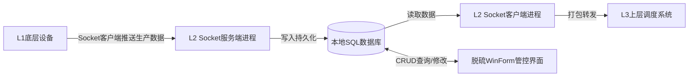
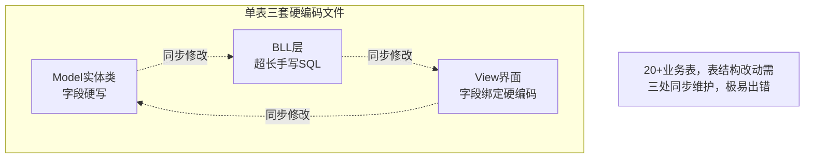
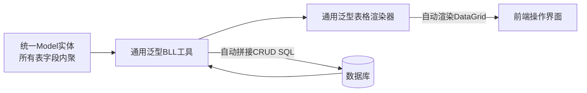
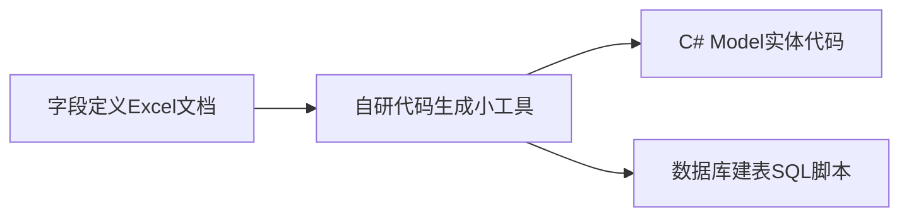
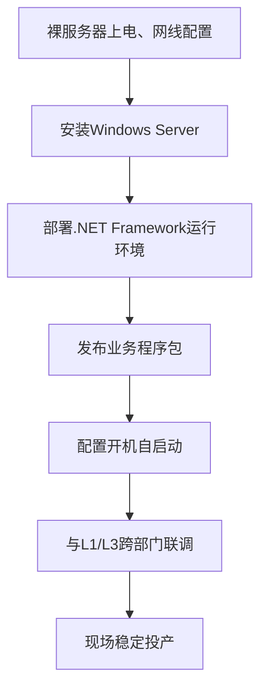
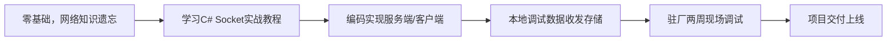
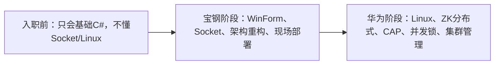

# 宝钢工程 - 钢厂L2层铁水脱硫&生产通信系统
> 首份职场工业软件项目复盘，核心能力：老旧系统重构、通用化封装、自动化代码生成、工业现场全流程交付
## 项目基础信息
- 周期：2年
- 技术栈：C# / WinForm / Socket / .NET Framework / SQL Server
- 场景：钢厂L2生产数据中转、脱硫业务可视化管控
- 职责：通信模块开发、界面全套实现、架构重构、现场独立部署

---

# 一、整体业务系统架构
## 系统分层数据流图

### 模块说明
1. 独立进程隔离通信与界面，互不阻塞s
2. 数据库作为中间缓存，完成上下层数据中转

# 二、重构前：原始架构痛点图

# 三、重构后：泛型+委托通用架构设计

### 重构收益
- 消除全量硬编码，单Model驱动全链路
- 新增数据表无需重复编写SQL、页面绑定代码

# 四、Excel自动生成代码工具工作流

# 五、现场服务器完整部署流程

# 六、入门项目：二炼钢L2通信模块开发流程

# 七、核心个人产出
1. 基于泛型、委托重构整套CRUD架构，消除大量重复硬编码
2. 开发Excel转Model/SQL生成工具，降低手工编码工作量
3. 独立完成从裸机到投产的整套服务器部署、网络联调
4. 从零实现Socket跨层级数据通信模块，掌握工业实时数据流开发

# 八、技术成长总结
1. 精通C#泛型、委托、面向对象落地实践
2. 具备老旧系统技术债务梳理、通用化重构能力
3. 掌握工业软件Socket通信、单机数据库分层架构
4. 建立工具化提效思维，完整走完工业项目交付闭环
5. 认清传统Windows工业软件技术局限，确定后续深耕分布式、Linux底层路线

## 使用建议
1. 图表优先级 > 文字
   你手绘时把5张Mermaid流程图单独美化，导出图片插入对应代码块下方，访客看图就能看懂整套系统逻辑，不用大段读文字；
2. 页面视觉轻量化
   所有描述文字全部压缩，只保留结论，核心逻辑交给图形承载，适配Github Pages阅读体验；
3. 后续华为项目文档可以沿用这套「Mermaid图+极简文字」统一风格，主页两套项目排版一致，观感专业；
4. 可补充优化：
   手绘时给架构图增加颜色区分：通信进程蓝色、数据库灰色、前端界面橙色，分层更清晰。

## 补充：如果想再加一张「技术成长路线对比简图」（可选）

放在文档最末尾，一眼体现你的技术成长递进，面试非常加分。