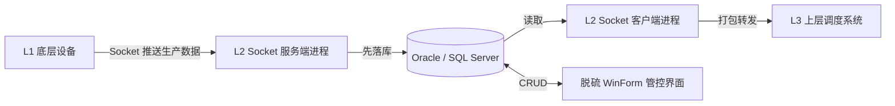
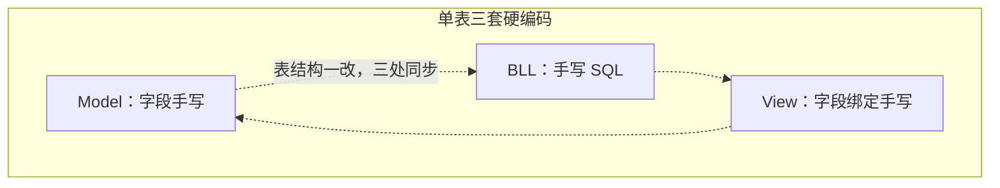
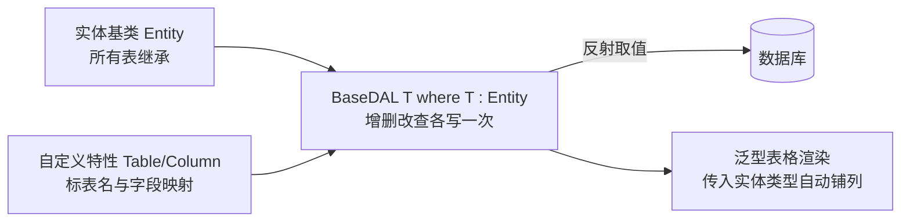
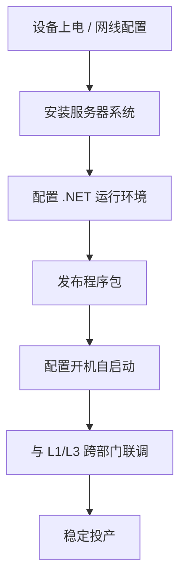

# 宝钢工程 — 钢厂 L2 铁水脱硫与生产通信系统

> 第一份工作，两年。核心是把一套二十多张表的重复代码收口成"改一处就生效"，并把改动的可追溯性、现场的部署与验证完整走了一遍。

---

## 项目基础信息

- 周期：2 年（2020.04 - 2022.03）
- 技术栈：C# / .NET Framework / WinForm / Socket / Oracle / SQL Server
- 场景：钢厂 L2 层生产数据中转、KR 铁水脱硫业务管控
- 职责：通信模块开发、界面实现、架构重构、现场独立部署

---

## 一、业务链路

两个设计选择：

1. **先落库再转发**，不做直接透传。任何一端断开，数据还在库里，重发就是重新读一遍。代价是库里要维护消息状态位（未读取 / 已读取 / 发送失败），用一张发送表承载。
2. **通信与界面拆成独立进程**，共享一个库，互不阻塞。

---

## 二、入门项目：二炼钢 L2 通信模块

两周开发 + 驻厂调试。做法是搭 Socket 服务端接 L1 数据落库，再用 Socket 客户端从库读出、按报文协议打包发 L3。

当时对网络编程几乎零基础，是从 Socket 收发 Demo 起步，逐段加业务做出来的。这个项目真正学到的是**定长报文怎么解**：协议包头固定包含长度、应用名、类型、返回码、节点号、日期时间、两个备用位、消息号，末尾是 ETX 校验位。所有字段定长，对端才能按偏移切。

还有一个当时自己想的做法：程序怎么证明自己活着。开一个后台线程，每秒把当前时间按 `ddhhmmss` 编码成整数写进一块**内存映射文件**（共享内存），外部程序读这块内存，数字超过一定时间没变就说明进程卡死。这是最朴素的进程心跳，后来做嵌入式端的看门狗，底层思路是一样的。

---

## 三、KR 铁水脱硫系统

业务主线：铁水从高炉来 → 进站 → 扒渣 → 加脱硫剂 → 搅拌 → 取样化验 → 出站，每一步都要留记录，并把结果回送 L2 与 MES。

系统没有消息中间件，**用数据库表当消息队列**：谁要通知谁，就往通知表里插一条，各程序轮询该表取走处理。土，但在预算有限的钢厂里很实用——没有额外组件要部署维护，数据库活着系统就活着。宁钢、青钢两个现场都是这套；青钢因预算不足，把 Oracle 换成了 SQL Server，做了大量适配。

### 3.1 重构前的问题

二十多张业务表，每张都配一套三件套：

表结构微调要同步改三处，漏一处就报错，且极易出现字段与 SQL 不一致。

### 3.2 重构后：泛型 + 特性 + 反射

- **数据访问收口**：`BaseDAL<TEntity> where TEntity : Entity`，增删改查各实现一次，二十多张表共用；
- **映射声明化**：表名、字段名不写在 SQL 里，用自定义 `TableAttribute` / `ColumnAttribute` 标在实体上，运行时反射读取；
- **界面通用化**：泛型方法传入实体类型，自动渲染 DataGrid 列。

效果：新增一张表 = 写一个实体 + 标特性 + 挂到界面，不再写第三份 SQL。

顺带还按 LINQ to DB 的思路自己试写过一层 `Linq2Oracle`（用特性描述映射、反射取表名），最后没写完——本质是在重造 ORM，表达式树那一层当时驾驭不了。但它逼着我去读 linq2db 的源码，弄明白了 ORM 在替我们做什么，收获比半成品本身大。

### 3.3 定长报文的特性化解析

青钢通信侧是定长报文，写了 `SocketFieldAttribute(起始位置, 长度)` 标在实体属性上，用反射按偏移切串、按类型转换后填对象。报文格式变了只改特性，不改解析函数——和后来做卫星通信时用 Schema 描述二进制帧，是同一种思路。

### 3.4 代码生成工具

项目字段定义由甲方以 Excel 提供。写了个小工具读 Excel，直接生成 C# 实体类与建表 SQL。二十张表手工抄两天，工具跑几秒，且不会抄错。

---

## 四、现场部署（青钢）

去的时候厂房尚未竣工，机房环境没人准备好。整套系统一个人从零拉起：

这段经历的价值不在于技术难度，而在于把"软件交付"完整走了一遍：不是在自己电脑上能跑，而是在别人的机房、断电重启之后还能自己起来、继续收数据。后来不管做什么，我都会先想它怎么部署、怎么被拉起、挂了怎么知道。

---

## 五、个人产出

1. 泛型基类 + 特性 + 反射重构 CRUD 架构，二十多张表从"三处同步"变成"一处定义"；
2. `SocketFieldAttribute` 定长报文映射，报文格式变更不再改解析代码；
3. Excel 一键生成实体与建表 SQL，消除手工抄写错误；
4. 从零实现 Socket 跨层级通信模块（含先落库再发、消息状态位、共享内存心跳）；
5. 独立完成从裸机到投产的服务器部署与跨部门联调。

---

## 六、复盘

- **能靠描述解决的问题，不要靠复制**：表结构、报文格式、字段定义，本质都是"声明"，一旦变成声明式，重复劳动就消失了。
- **交付才算完成**：日志、部署步骤、开机自启、进程存活检测，这些当时觉得很"外围"的东西，后来发现才是能不能上现场的分水岭。
- **看清了自己的短板**：理论不够硬、视野不够宽、容易被环境推着走。这也是后面离开的原因。
