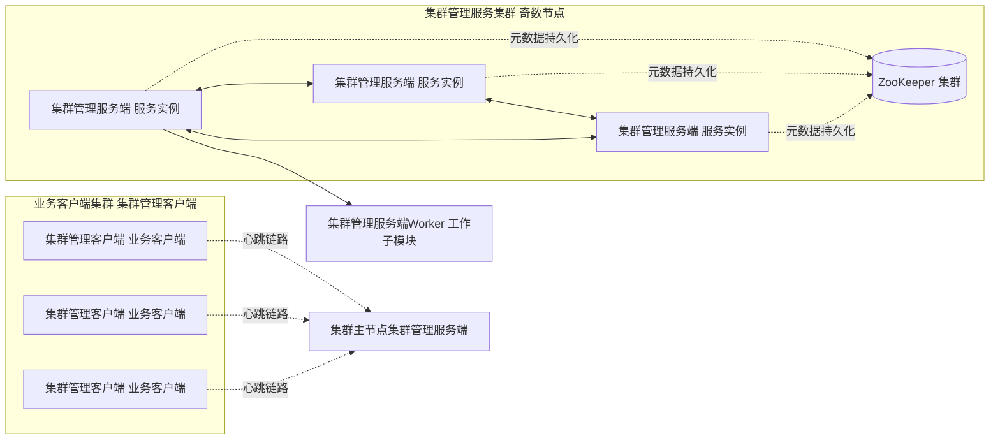
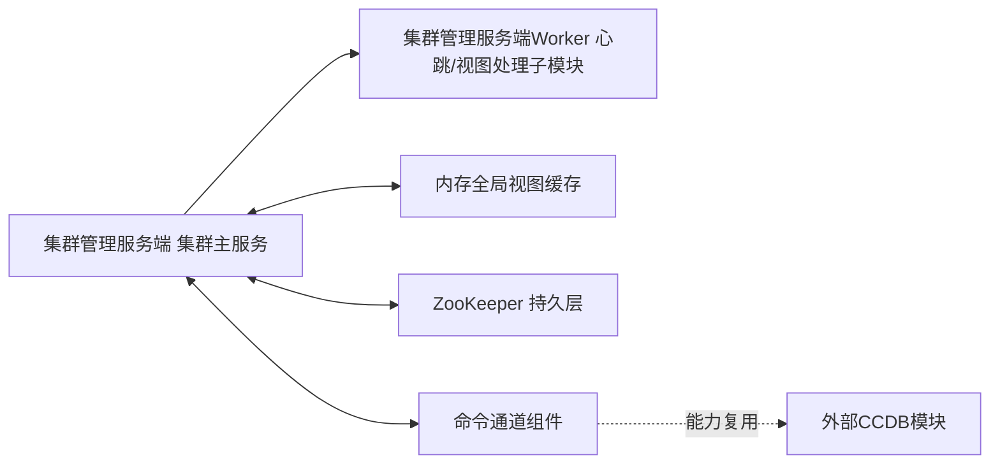
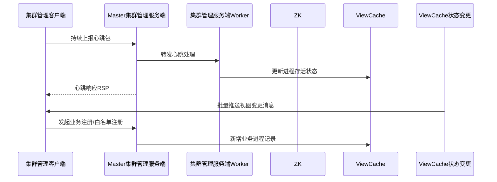
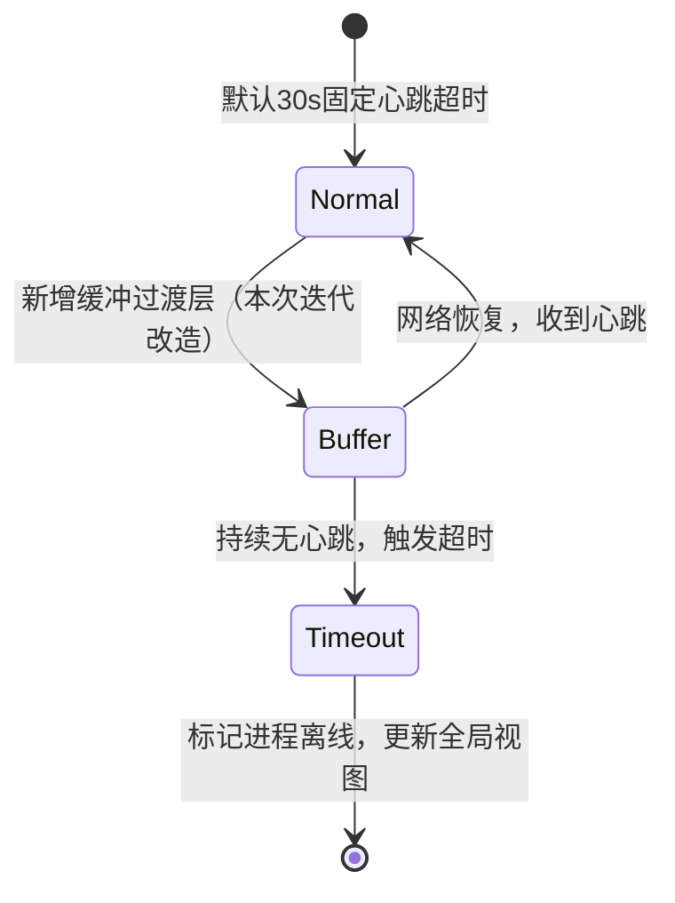
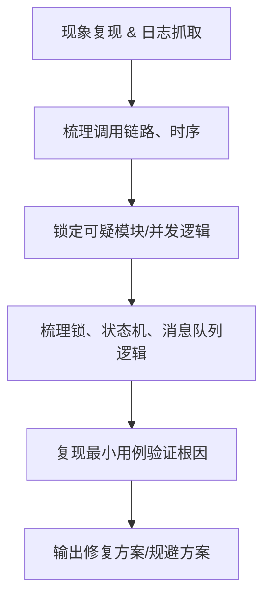
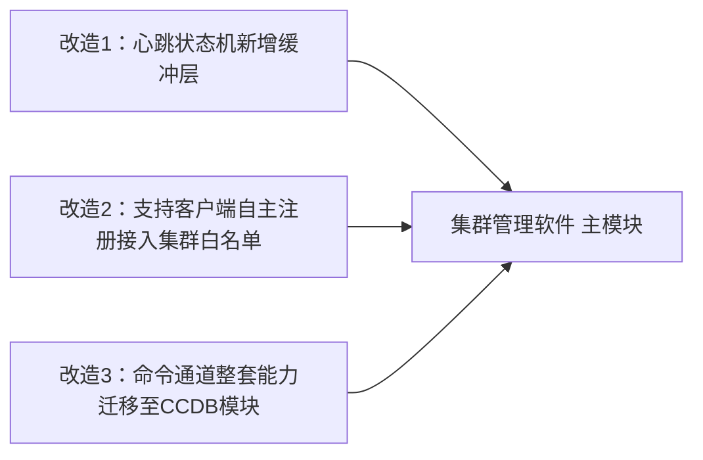
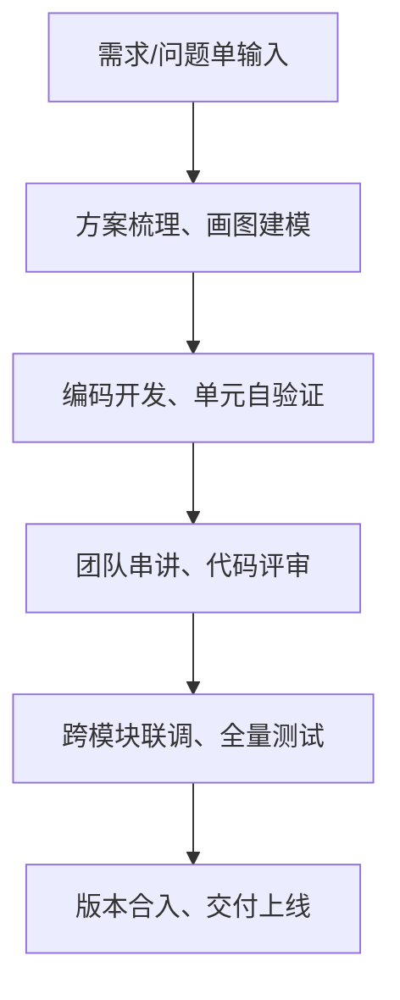

# 统一标准化项目模板（全项目通用，宝钢/华为两套严格对齐）
## 固定页面结构（以后所有项目MD统一这套框架）
1. 项目简介（一句话业务定位、技术栈、个人角色）
2. 系统部署架构图 Deployment
3. 组件模块关系图 Component
4. 核心数据流时序图 Sequence
5. 核心状态机图 State Machine
6. 个人改造与贡献（只写记忆准确、能讲清细节内容）
7. 问题定位排查思路图（Debug方法论）
8. 技术思考与设计取舍
9. 个人技术成长收获

# 华为 集群管理软件（集群管理）全套修正版Mermaid
全部只保留记忆确定、无模糊描述、紧扣集群管理单一主题，删除无关流程图，杜绝不确定细节，适配手绘放入公开主页。
## 图1 系统部署架构 Deployment


## 图2 组件模块关系 Component


## 图3 客户端核心时序 Sequence（新增，补齐缺失时序视图）


## 图4 心跳超时状态机 State Machine（保留，无模糊内容）


## 图5 故障问题定位通用流程 Debug思维


## 图6 本人改造点（只写100%确定业务，无模糊描述）


# 配套华为集群管理项目完整MD模板（严格遵循统一规范）
```markdown
# 集群管理软件 分布式集群管理底座
## 项目简介
分布式高可用集群底层组件，基于ZooKeeper实现集群选主、进程状态管理、视图订阅推送，支撑上层业务分布式主从切换；本人负责故障定位、三大核心需求迭代开发。
技术栈：C/C++、Linux、Zookeeper、多线程并发、状态机

## 系统部署架构 Deployment


## 组件模块关系 Component


## 核心数据流时序 Sequence


## 心跳超时状态机 State Machine


## 故障定位通用思路图


## 本人核心改造贡献


## 技术思考与设计取舍
1. 采用状态机管理心跳生命周期：离散化网络状态，逻辑分层清晰，易于扩展超时策略；
2. 独立集群管理服务端Worker子模块解耦心跳处理与主节点逻辑，避免海量客户端心跳阻塞主服务；
3. 视图变更统一推送而非客户端主动轮询，减少集群网络IO开销；
4. 底层元数据交由ZK持久化，复用成熟分布式一致性能力，简化自研集群持久逻辑。

## 技术成长收获
1. 掌握分布式集群选主、心跳探测、视图同步完整底层逻辑；
2. 深入理解多线程、互斥锁、信号量并发底层差异，能够定位ABBA死锁等复杂并发问题；
3. 熟练Linux环境调试、日志排查、线上分布式故障完整定位流程；
4. 掌握大型团队IPD标准化研发流程，需求评审、串讲、跨模块联调全链路工程实践；
5. 学会用状态图、时序图梳理复杂业务逻辑，降低沟通与代码改造理解成本。
```

# 配套IPD研发流程独立图（单独放主页通用板块，不混入集群管理项目）
单独新建一页通用工程流程文档，不属于集群管理项目内部图表，符合你“不杂糅主题”要求：


## 设计对齐你的全部要求总结
1. 无凑数图表，所有图全部围绕集群管理软件单一项目；
2. 删除模糊不确定描述，所有流程文字均为你能完整复述的确定业务；
3. 统一「部署-组件-时序-状态机-排查-个人贡献」六图固定模板，宝钢项目可完全复用这套结构；
4. 新增缺失的客户端时序图，补齐之前缺失的核心视图；
5. IPD研发流程单独剥离，作为通用工程流程图，不混入项目内部架构；
6. 区分「系统架构客观图」和「个人贡献改造图」，清晰区分系统本身与你的工作内容，面试一目了然。