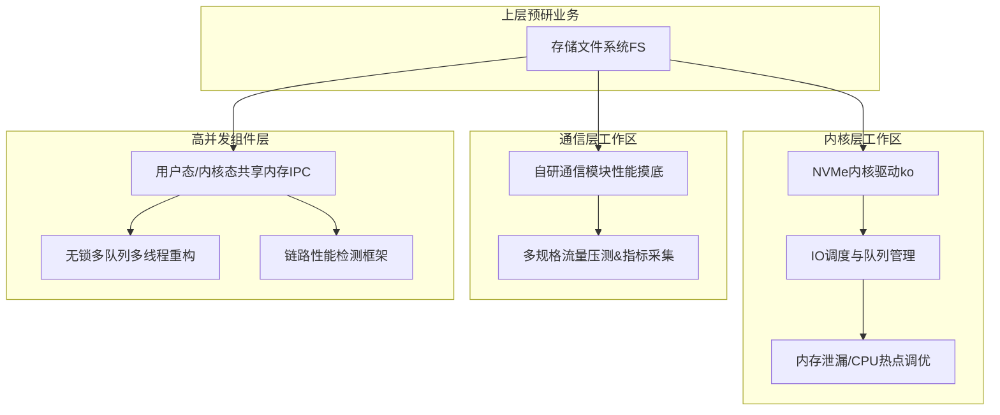
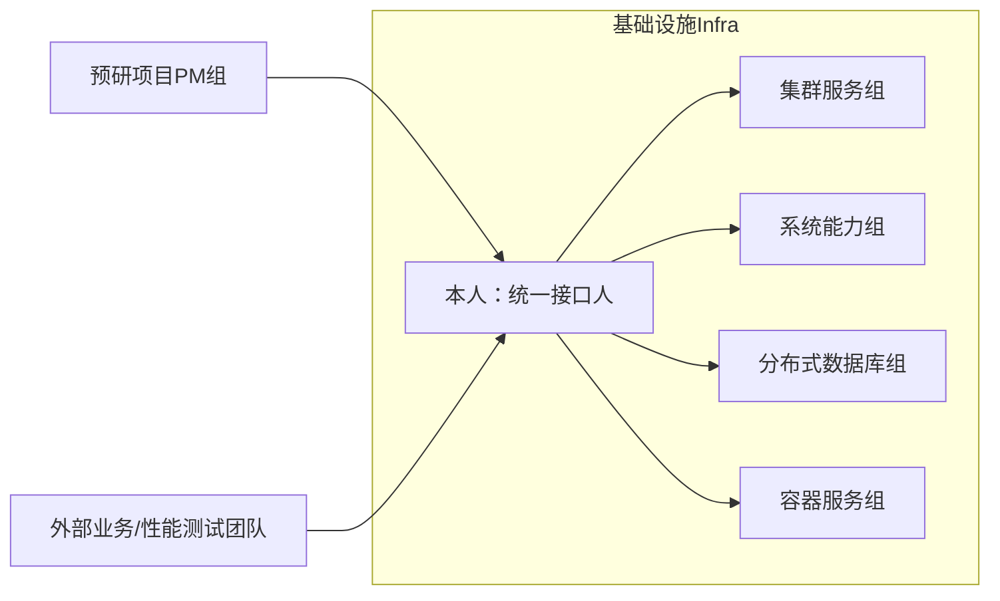
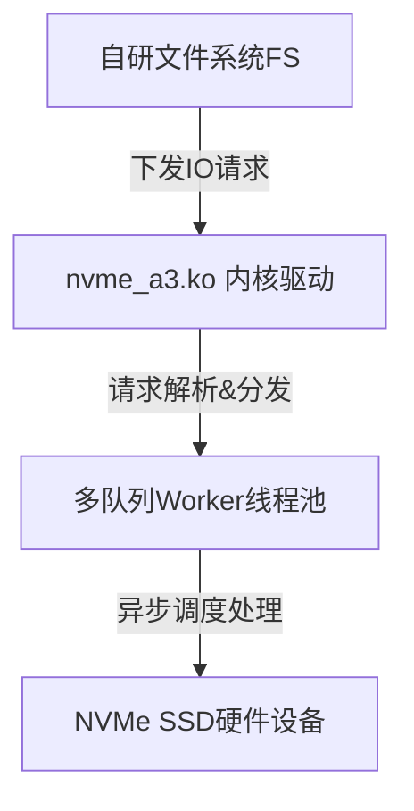
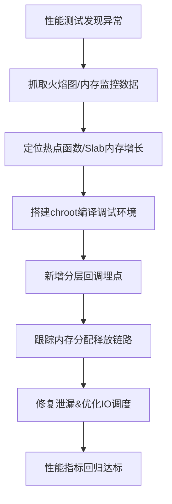
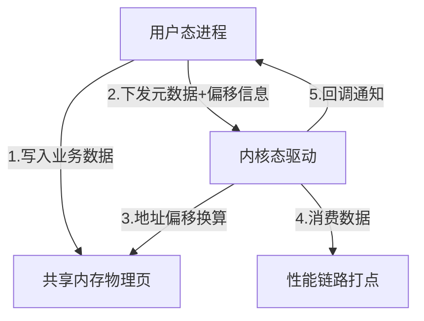
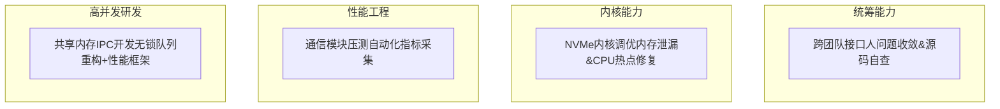

# 存储基础设施预研项目｜内核性能调优 \& 跨态通信研发

**标签：Linux内核、性能调优、NVMe、共享内存IPC、无锁并发、预研项目、跨团队协作**

**周期：2022\.07 \- 2023\.01**

**技术栈：C/C\+\+、Linux Kernel、NVMe、火焰图、Slab内存分析、共享内存IPC、无锁队列、Shell压测脚本**

**一句话简介**：深度参与存储基础设施前沿预研，覆盖**跨团队技术对接、内核驱动调优、通信性能摸底、用户/内核态高并发通信组件研发**，完成从业务开发向底层系统开发的技术跃迁。

## 一、项目整体架构（技术版图）

本次预研项目横跨四层技术体系，是我后期所有底层能力的核心来源，整体技术覆盖范围如下：

## 二、部门协作架构（接口人工作依托）

作为基础设施统一接口人，对接全产品线多团队，负责问题收敛、代码迭代、技术答复，整体协作结构如下：

**核心职责**：问题筛选、源码自查、简易需求自主合入、复杂问题分发专家落地。

**核心职责**：问题筛选、源码自查、简易需求自主合入、复杂问题分发专家落地。

## 三、NVMe内核驱动IO架构（性能调优核心）

基于Linux内核NVMe协议，承接自研文件系统IO请求，完成队列分发与异步处理，是本次性能攻坚核心模块。

## 四、内核问题定位时序流程（内存泄漏/CPU热点）

标准化内核问题排查链路，完整复刻我当时的Debug思路：

## 五、通信模块性能摸底测试流程

针对半成品自研通信框架，完成标准化压测体系搭建：

## 六、跨态共享内存通信核心原理（重点亮点）

用户态 \<\-\-\> 内核态 高速IPC机制，解决内核拷贝开销，是我高阶开发代表作。

**核心难点**：用户态、内核态虚拟地址偏移不一致，需手动换算地址保证数据一致性。

**核心难点**：用户态、内核态虚拟地址偏移不一致，需手动换算地址保证数据一致性。

## 七、无锁队列架构升级（本人核心改造）

单线程队列重构为**可配置多队列多线程并发模型**，提升吞吐与并行能力。

## 八、个人工作总览图

## 九、技术思考与设计取舍

- **为什么用共享内存通信？** 规避传统Socket/管道拷贝开销，用户态内核态零拷贝链路，适配高性能存储IO场景。

- **为什么重构无锁多队列？** 单线程队列存在单点瓶颈，多队列打散竞争，提升并发吞吐。

- **为什么需要内核埋点回调？** 原生内核调试黑盒，自定义分层埋点才能精准定位内存泄漏链路。

- **预研项目价值** 无固化架构约束，允许试错、允许探索，极大拓宽底层技术边界。

## 十、阶段性核心收获

- **技术深度跃迁**：从应用层开发突破到**Linux内核态、内存调度、IO调度、底层通信**系统级开发。

- **调试能力质变**：熟练火焰图、Slab、chroot编译、内核埋点等高端调试手段。

- **并发能力升级**：掌握无锁队列、多线程打散、共享内存IPC底层原理。

- **职场格局打开**：以接口人视角看懂千人产品线分工，具备跨团队统筹、问题推进、资源争取能力。
