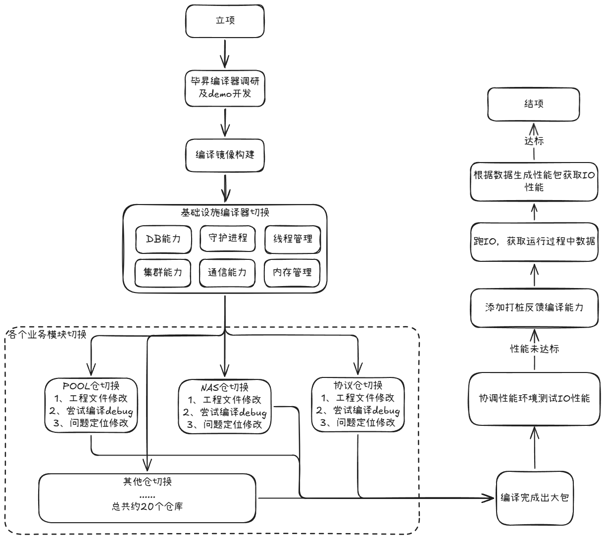
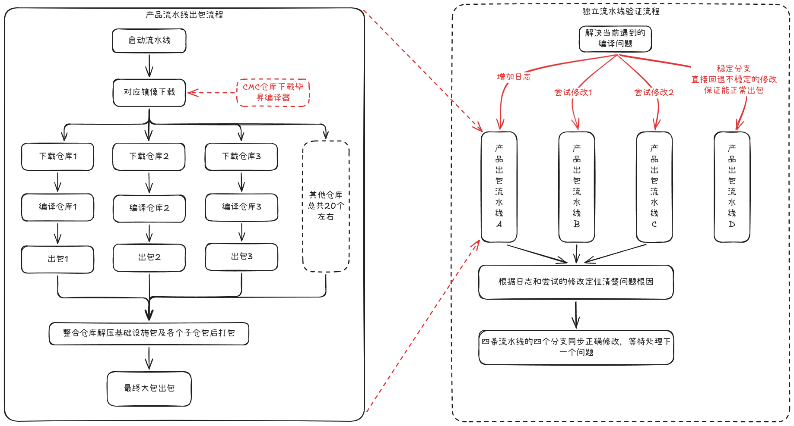
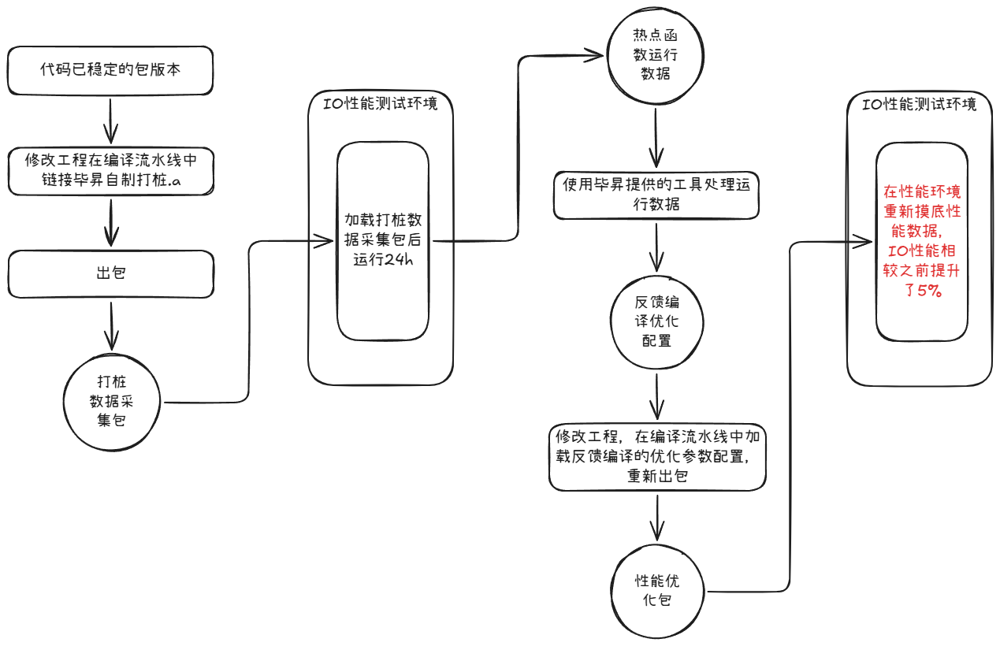

# 千万行级软件栈编译器迁移实践

## GCC → 毕昇（Clang/LLVM）Toolchain 验证项目

---

## 一、项目背景
存储产品线长期基于GCC工具链构建，存在开源协议风险、供应链单一、优化能力不足等痛点。2012实验室自研毕昇编译器基于Clang/LLVM架构，规避断供风险，同时提供内存排布、循环向量化等IO场景专属优化。
本项目为存储国产化编译栈前置验证项目，完成OceanStor集中式存储全软件栈编译器迁移落地。

- **承载产品**：OceanStor Pacific / Dorado 6.2.0 集中式存储IO核心软件栈
- **软件规模**：20+代码仓、千万行级C/C++代码
- **二进制体量**：约2GB（IO静态库统一打包，单进程部署）
- **核心项目目标**：验证毕昇编译器大规模商用落地可行性，整机IO性能提升10%
- **项目特性**：预研攻坚项目、无专项资源、技术风险高、跨多部门协同

---

## 二、核心挑战
### 1. 构建体系碎片化，改造难度大
各模块编译脚本自治，GCC参数无统一规范；大包流水线链路长，串行调试反馈周期长，项目推进效率低。

### 2. 编译器底层差异大，兼容问题密集
GCC与LLVM在校验规则、链接逻辑、扩展语法存在底层差异，存量代码大量依赖GCC宽松特性，切换后告警升级、链接失败问题集中爆发。

### 3. IO链路性能敏感，调优闭环门槛高
存储业务对指令、缓存、循环优化高度敏感，仅编译通过无法交付，必须完成全链路性能调优验证。

### 4. 跨团队协同成本高
覆盖全量IO核心模块，涉及多部门权限、构建适配、编译策略评审，需联动存储架构、编译器团队联合决策。

---

## 三、迁移总体策略
采用**基建先行、分层递进、先稳后优**落地策略，规避批量改造雪崩风险：
1. 底层基础设施优先适配，筑牢依赖底座
2. 按IO链路优先级分批切换业务模块
3. 分三阶段推进：编译适配 → 功能冒烟验证 → PGO深度性能优化

---

## 四、CI/CD验证架构设计
### 1. 独立隔离流水线策略
无工程团队定制镜像支持，改造集群管理客户端编译流程，流水线自动拉取、部署毕昇编译器包，搭建隔离构建环境，新旧编译链路互不干扰。

### 2. 创新并行验证方法论（核心效率亮点）
设计四分支并行验证机制，单人多维度同步推进问题攻坚：
- 问题定位分支：新增日志埋点，定位编译、链接、运行异常
- 尝试修复分支：快速验证单类问题修复方案
- 对比方案分支：并行测试多套适配策略择优落地
- 稳定基线分支：留存可运行版本，用于常态化性能基准测试

---

## 五、编译选项体系化治理
全量梳理不兼容编译参数，联合多角色专家评审，建立标准化适配规范：

|适配类型|治理策略|落地说明|
|---|---|---|
|可删除选项|直接移除|无编译、功能、性能风险，直接清理|
|可替换选项|Clang等效替换|使用LLVM原生参数替代GCC专属扩展|
|默认支持选项|取消显式配置|编译器内置能力，无需手动声明|
|暂不支持选项|需求闭环迭代|汇总短板，推动编译器团队迭代补齐能力|

---

## 六、典型问题案例沉淀
### 案例1：静态库链接顺序严格性差异
**现象**：单模块编译正常，整体大包链接报undefined reference。
**根因**：LLVM链接器符号解析规则更严格，循环依赖库符号解析失败。
**解决方案**：梳理库依赖拓扑，使用`--start-group/--end-group`包裹循环依赖库。

### 案例2：严格校验导致告警升级报错
**现象**：代码无变更，Warning升级为Error阻断构建。
**根因**：Clang语法、类型校验标准高于GCC，拦截存量不规范代码。
**解决方案**：分级治理，无害告警兼容关闭，代码缺陷统一修复。

---

## 七、PGO反馈编译性能优化闭环
落地PGO探针反馈式编译，形成完整性能调优链路：
代码插桩编译 → 线上IO压力采样 → 采集热点函数剖面 → 生成加权优化参数 → 定向重编译

**优化逻辑**
- 热点IO函数：激进内联、循环展开、缓存局部性优化，降低IO路径开销
- 低频冷门函数：轻量化编译，控制镜像体积与编译耗时

---

## 八、项目最终成果
- ✅ 完成千万行级存储全栈编译器迁移，底层基建与业务模块全部适配完成
- ✅ 全量冒烟、功能回归测试稳定，全新编译链路常态化可用
- ✅ PGO优化后整机IO性能提升5%，基于早期编译器版本客观闭环上报
- ✅ 完整沉淀迁移手册、编译规范、问题解决方案、流水线改造文档
- ✅ 标准化迁移方法论支撑6.2.1产品化落地，对外赋能其他产品线

---

## 九、核心方法论与组织价值沉淀
1. 大型软件栈分层落地，由底向上分批迭代，降低改造风险
2. 长流水线采用多分支并行验证，解决串行调试低效痛点
3. 统一治理编译参数，跨团队评审规避零散适配遗留技术债务
4. 性能优化依托真实业务剖面PGO，实现精细化定向调优
5. 个人攻坚经验沉淀为通用技术资产，降低全产品线国产化迁移成本

---

## 十、个人核心职责与贡献
项目无专项负责人、无额外人力、无工程资源支撑，本人为唯一核心负责人，全程独立统筹落地：
- 整体迁移方案、落地路径、风险管控全权设计推进
- 自主搭建隔离LLVM编译流水线，突破无定制镜像环境卡点
- 创新多分支并行验证机制，单人完成千万行代码适配攻坚
- 牵头跨部门技术评审，对齐架构、编译器团队统一适配标准
- 独立落地PGO性能优化全链路，完成指标验收闭环
- 输出全套复用文档与宣讲材料，支撑产品迭代与跨团队技术答疑支撑