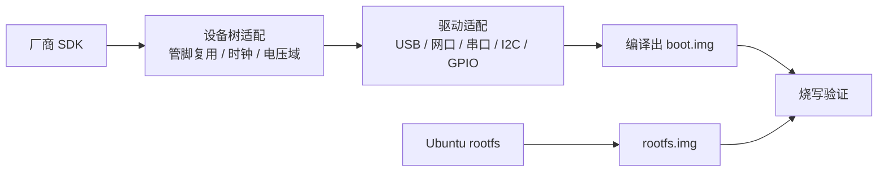
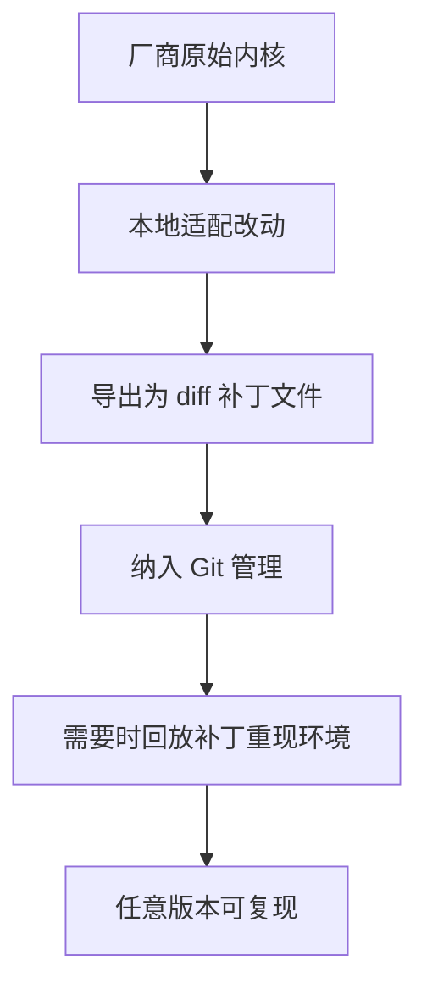

# 🔧 RK3588 固件适配与驱动调试体系

> 在厂商 SDK 基础上完成设备树与驱动适配，把「改一处、等一轮」的硬件调试变成可追溯、可自动验证的流程

## 项目基础信息

| 项目名称 | 自研硬件平台驱动适配与调试体系构建 |
|-----------|------------------------|
| 周期 | 2025.07 - 2026.08 |
| 技术栈 | Linux Kernel / 设备树 / I2C / SPI / UART / GPIO / U-Boot / shell / Git |
| 场景 | 多款自研板卡（EVB / LMB）的固件适配、驱动验证与回归 |
| 职责 | 固件构建、设备树与驱动适配、驱动自动化测试工具开发 |

---

# 一、问题背景

公司使用多款自研板卡，硬件迭代快，但缺少可复现的固件适配与回归手段，具体表现为三个痛点：

| 痛点 | 具体表现 |
|------|----------|
| 适配过程不可追溯 | 厂商提供的 SDK 直接改在源码树里，改动散落无记录，出问题无法定位是哪次修改引入的 |
| 内核目录过于庞大 | 完整 kernel 源码体积大、直接纳入版本管理成本高，导致「干脆不纳管」 |
| 验证全靠人工 | 每次改完驱动都要人工上板、逐项点验，一轮验证周期以小时计 |

---

# 二、固件适配工作

## 2.1 从厂商 SDK 到可交付固件

在代理商提供的稳定版 SDK 基础上完成适配，最终产出 `boot.img` 与 `rootfs.img` 两个可烧写镜像：

| 环节 | 内容 |
|------|------|
| 设备树适配 | 按硬件改版调整管脚复用、时钟与电压域配置，解决外设识别不到类问题 |
| 驱动适配 | 适配 USB、网口、串口、I2C、GPIO 等外设，处理时序与供电相关问题 |
| 文件系统替换 | 用 Ubuntu rootfs 替换板卡自带的 buildroot，打通包管理与调试工具链 |
| 固件产出 | 统一编译产出 `boot.img` 与 `rootfs.img`，形成可重复的交付物 |

## 2.2 内核改动的版本管理

完整内核源码树体积过大，直接纳入 Git 管理代价高。采用的折中方案是**只对改动做版本管理**：

这条链路的价值在于：内核主体不纳管，但**每一处适配改动都有记录、可回放**，环境重建从「靠记忆重来一遍」变成「打一串补丁」。

---

# 三、驱动自动化测试

## 3.1 从人工点验到脚本化报告

原来的验证方式是人工上板逐项操作，一轮下来以小时计。改成在板卡上直接执行的 shell 测试脚本，自动遍历外设并生成结构化报告：

| 改进点 | 效果 |
|--------|------|
| 验证方式 | 人工逐项点验 → 单条命令全量执行 |
| 验证周期 | 约 3 小时 → 约 2 分钟 |
| 结果形态 | 口头确认 → 结构化报告，可归档比对 |
| 异常定位 | 靠现场复现 → 报告自带现场信息 |

## 3.2 调试手段的组合

| 手段 | 用途 |
|------|------|
| 示波器 / 逻辑分析仪 | 定位时序问题、电平与供电异常 |
| GDB | 内核与用户态崩溃现场分析 |
| dmesg / 内核日志分级 | 区分驱动加载失败与硬件未识别 |
| 压力测试脚本 | 外设长时间运行稳定性验证 |

---

# 四、成果

- 完成多款自研板卡的固件适配与交付，形成可重复的镜像构建流程
- 将内核适配改动纳入补丁化管理，环境重建可复现
- 单板卡驱动验证周期从约 3 小时压缩到约 2 分钟
- 发现并推动修复 10+ 个硬件设计与时序缺陷
- 与加密芯片、GNSS 模组等关键器件厂商完成技术对接，快速闭环兼容性问题

---

# 五、复盘

- **硬件问题的成本曲线极陡**。软件 bug 可以热修，硬件时序问题一旦流到产线就是批量返工，所以自动化回归的优先级必须高于「先把功能做出来」。
- **不可追溯的改动等于没有改动**。内核目录太大不是不纳管的理由，把改动抽成补丁就能同时拿到「轻量」和「可追溯」，这是一个成本很低的折中。
- **验证工具本身要能自证**。测试脚本如果自己出错，比没有测试更糟，所以报告里必须带现场信息，让人能判断是「真的过了」还是「脚本没跑到」。