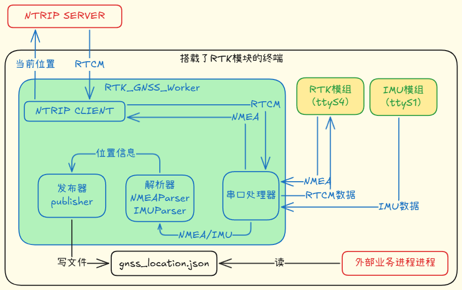

# RTK GNSS Worker — 实时厘米级定位服务

---

## 1. 文档信息

| 项目名称 | RTK GNSS Worker — 实时厘米级定位服务 |
|-----------|------------------------|
| 编写人 | 金英杰 |
| 技术栈 | Python / pyserial / NTRIP / NMEA 0183 / Docker / socat |

---

## 2. 需求背景与目标范围

### 2.1 背景
终端上挂载 RTK 模组后，可以获得厘米级定位能力。模组本身只负责解算，真正要把能力交付出去，需要一条持续的链路：从 NTRIP 服务商取 RTCM 差分数据 → 通过串口灌给模组 → 从模组读回 NMEA → 解析出经纬度与定位质量 → 以约定格式交给下游业务进程。

接手时已有一个能跑的最小版本，但缺重连、缺日志、没有统一输出，断线后无人接管。本项目目标是把它做成可以长期运行在无人机上的组件。

### 2.2 目标范围
- 接入 NTRIP Caster，接收 RTCM 差分数据并转发给 GNSS 模组；
- 解析 NMEA 语句（GGA / RMC），提取位置、质量、卫星数与 HDOP；
- 把位置标准化为 JSON 并原子写入文件，供下游进程按秒读取；
- 支持串口与 TCP 两种接入方式（后者便于无硬件测试与容器化）；
- 不包含硬件驱动、坐标系转换（仅 WGS84）与差分账号运维。

---

## 3. 软件整体架构

### 3.1 系统架构图

### 3.2 模块划分
| 模块 | 类型 | 职责 |
|------|------|-----------|
| `ntrip_client` | 网络客户端 | 连接 NTRIP Caster 收 RTCM；解析源表自动纠错挂载点；周期发送 GGA 心跳 |
| `serial_handler` | 接入层 | 串口 / TCP 双模式，提供 `read_nmea()`、`write_rtcm()` |
| `nmea_parser` | 数据解析 | 校验和验证，解析 GGA / RMC，输出 `LocationData` |
| `location_publisher` | 发布模块 | 原子写入 JSON 文件，或走回调 |
| `gnss_worker` | 主控制器 | 启停两条工作线程（RTCM 下行 / NMEA 上行），维护位置状态与回调 |

---

## 4. 模块设计

### 4.1 NTRIP 差分接收（`ntrip_client`）

* TCP 连接 Caster，以 Basic 认证构造 NTRIP 请求，用 `ICY 200 OK` 作为连接成功判据；
* 对响应分类处理：`401/403` 视为账号问题直接失败；返回源表（`SOURCETABLE`）时解析 `STR;` 行取得可用挂载点，自动切换后重连，避免挂载点配错时无限重试；
* 具备重试次数与超时控制；收到的 RTCM 字节流原样交给串口层，不做二次解析；
* 周期发送 GGA 心跳（默认 30s），用最新位置拼装，维持 Caster 会话。

### 4.2 串口与数据接入（`serial_handler`）

* 按配置判定串口还是 TCP：显式 `host`、`socket://`、`tcp://` 前缀或整型端口都走 TCP；
* 串口按 `baudrate/timeout/bytesize/parity/stopbits` 打开（默认 115200-8-N-1），TCP 侧按行读取；
* 对外提供统一语义：`write_rtcm()` 写差分、`read_nmea()` 读一行 NMEA，屏蔽底层差异。

### 4.3 NMEA 解析（`nmea_parser`）

* 先做异或校验和验证，校验不过的语句直接丢弃，避免脏数据污染下游；
* 解析 GGA（位置 / 质量 / 卫星数 / HDOP / 海拔）与 RMC（位置与有效性）；
* 将 `DDMM.MMMM` 度分格式转为十进制度，南纬西经取负；
* 输出统一的 `LocationData`，并保留原始语句便于排障。

### 4.4 位置发布（`location_publisher`）

* 默认文件输出，采用原子写：写临时文件 → `fsync` → `rename` 覆盖；Windows 下先删目标再改名；
* 按 `update_interval` 节流，避免下游读到的频率高于实际定位频率；
* 另提供回调发布方式，供同进程内的业务直接消费。

### 4.5 主控制器（`gnss_worker`）

* 启动两条独立线程：`_rtcm_worker` 负责 NTRIP→串口，`_nmea_worker` 负责串口→解析→发布，避免一个方向阻塞拖死另一个方向；
* 共享位置状态加锁保护，心跳逻辑读取最新位置；两线程各自捕获异常后短睡重试，单点故障不导致整体退出；
* 提供 `start/stop/get_status`，接入信号处理，支持 systemd 托管。

---

## 5. 测试与验证

手上没有多余的 RTK 硬件，板子上验证一次要烧固件、接线，成本很高。因此整条链路都做成能在没有硬件、没有板子的情况下自证：

| 手段 | 做法 | 价值 |
|------|------|------|
| 虚拟串口 | `socat` 创建一对 pty，`virtual_gnss.py` 按 1Hz 写入模拟 GGA，另一侧监控 RTCM 回流 | 无硬件打通完整数据流 |
| 容器化集成测试 | `docker-compose` 起 `ntrip-mock`（真实回 `ICY 200 OK`/源表/401）与 `serial-mock`（1Hz 吐 NMEA），均带 healthcheck，测试容器等 healthy 后启动 | 环境一致、可 CI |
| 分层测试 | 单元（解析 / 校验和 / 原子写 / 认证）、集成与端到端（RTCM 转发、双线程独立、端到端出位置）、系统（断网恢复、磁盘写满、并发访问、波特率与路径校验）、架构（线程分离、错误隔离、循环依赖），共 67 个测试 | 改动可回归 |
| 一键执行 | `run_docker_test.sh` 编排 compose、等健康检查、按序执行、收集服务状态与日志；另有 `pytest --html` 单文件报告 | 结果可交付、可归档 |

约束：测试只在容器内运行，不提供本地直跑，避免"本地过了容器里挂"。

---

## 6. 交付与运行

- `release.sh` 把 `src/config/启动脚本` 打成 tar，附 `VERSION`、`FILES.txt` 与 sha256，包内自带 `deploy.sh`、`start.sh`；
- 设备侧由 systemd 托管，开机自启、异常自动拉起；
- 位置固定输出到 `gnss_location.json`，下游（RemoteID、加密链路的 rid）按文件契约读取，组件之间不产生代码依赖。

---

## 7. 复盘

- **先定输出契约，再拆数据流，最后写代码**：位置该给谁、以什么格式给，决定了整个组件的形态。
- **能用文件就不用中间件**：板子资源有限，一个原子写的 JSON 比引入消息队列更合适，代价是下游必须容忍读到"上一秒"的值。
- **测试环境比测试用例更值钱**：mock 服务搭起来之后，任何人都能在没有硬件的情况下验证改动。
