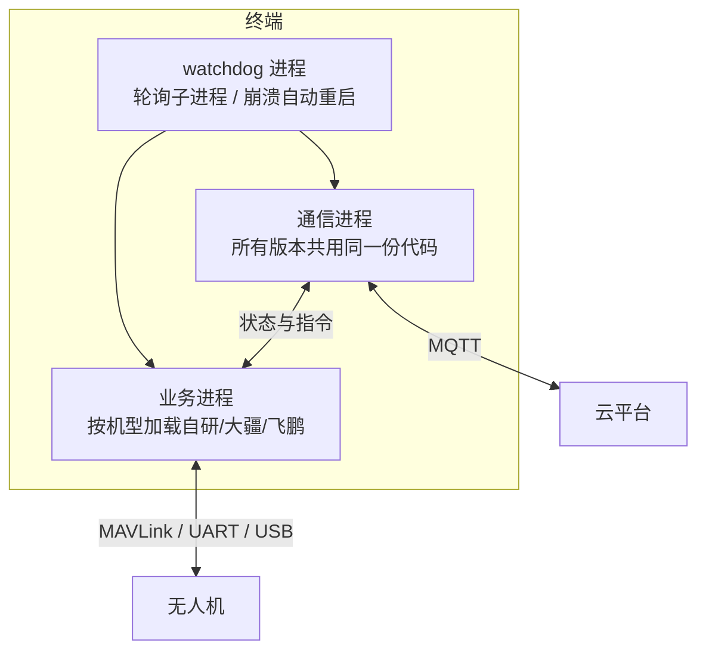
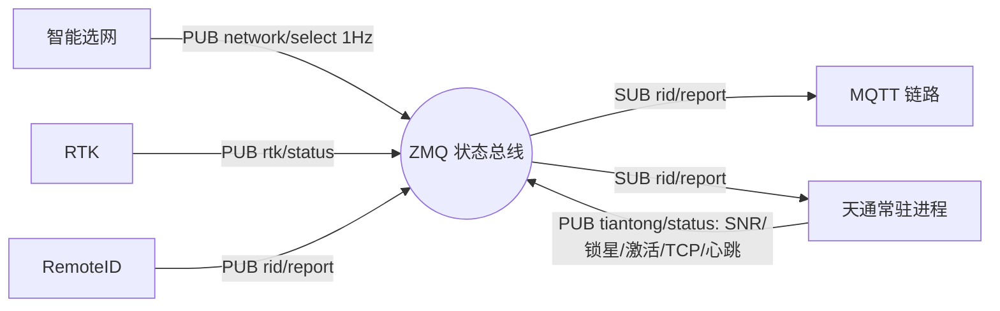
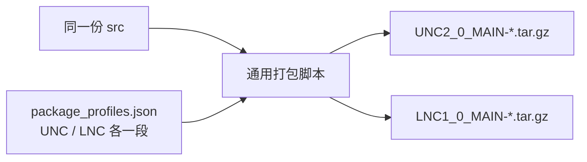

# LNC / UNC 双产品线代码统一与交付体系

> 一个仓库同时产出两套交付包；差异收敛在配置与打包层，不在业务代码里。

---

## 1. 背景

公司两条产品线跑同一套业务：UNC 是 32 位小终端（SG2002，最初 buildroot，后替换为 Ubuntu），LNC 是 64 位 RK3588（Ubuntu）。业务内容高度一致——MQTT 连平台、MAVLink 连飞机、状态与事件上报、RTK 定位、RemoteID、一机一码。

最初的应对方式是分支加复制代码。结果很直接：同一个 bug 要改两遍，漏改一遍就是两个产品行为不一致；测试也得测两遍；版本之间无法追溯谁在哪个分支上。

**目标：代码只有一份，产品差异只体现在配置和打包上；一个仓库同时产出 UNC 与 LNC 的交付包；变更可回归、发版可追溯。**

---

## 2. 架构设计（进程层）

以 UNC 2.0 的架构说明为基准，把系统切成三个角色：



- **通信进程**：唯一一份代码实体，所有版本共用。负责平台 MQTT 通信、飞机通信、状态与事件上报。加新机型不用动它。
- **业务进程**：启动时读取机型配置，决定加载自研、大疆还是飞鹏那一套实现。
- **watchdog**：自己实现，轮询子进程状态，退出或僵死则延时重启；收到终止信号时按顺序收尾，避免僵尸进程。

**通信进程内的线程与队列**（关键点是"每个方向一条独立的路"）：

| 线程 | 职责 |
|------|------|
| socket 服务线程 | 与业务进程/飞控收发数据，收到即入队 |
| 消息转发线程 | 每秒取一次 socket 队列，把飞机数据转成 MQTT 上报 |
| 消息下发线程 | 把 MQTT 收到的指令转到 socket，下发给飞控 |

硬约束：**paho 的 MQTT 回调里只入队、不做业务**。否则网络线程一旦被业务拖住，心跳就断，平台侧判定离线。

**业务能力编排链路**：

```
飞控(MAVLink over UART/USB) → RTK 串口取 NMEA → 厘米级位置
   → RemoteID 组包 → 网络式走 MQTT / 广播式走蓝牙(ESP32)
   → 敏感字段由一机一码模块透明加解密
```

安全与运维策略落在这一层：断网超过配置时长（默认 5s）主动触发返航；电量低于机型阈值触发返航；OTA 只在地面升级、失败自回滚；日志按天滚动保留 30 个文件、四级分级、两个进程分文件落盘。

---

## 3. 演进设计（模块层）

天通与 RemoteID 接入后暴露了两个结构问题：

1. 天通链路每次切换都要重新锁频、激活、建 TCP，切一次等很久；
2. RemoteID 直接往通信模块的 Unix Socket 写数据，把"下游是谁"写死了，加一条链路就要改它。

优化方向是**从命令驱动改为状态驱动**：内部用 ZMQ 做状态总线，各模块自己发布状态、按需订阅。



- RemoteID 只往 `rid/report` 发，不再关心下游是 5G 还是卫星；新增链路只要订阅它；
- 天通改为常驻进程并做链路预热，状态机为 `INIT → LOCK → ACTIVATE → CONNECT → READY → ACTIVE`，`READY` 表示链路随时可用但未承载业务，选网结果一到直接进 `ACTIVE`，切换只切业务路径；
- 选网不再"启动/停止天通"，而是 1Hz 广播选网结果，各链路自己判断是否承载。

原则：**模块之间通过状态耦合，不通过调用耦合。**

---

## 4. 工程实现（打包层）

一个仓库两套产物，靠一张配置表驱动：



`package_profiles.json` 里描述的是**差异**，不是流程：

| 配置项 | 作用 |
|--------|------|
| `bin_copy_mode` / `bin_subdir` | 从 `arm32` 还是 `arm64` 子目录取二进制 |
| `remove_paths` | UNC 不要 `dji_psdk`，LNC 不要 `uav_refactoring` |
| `moves` / `move_contents` | `OTA_client`、`start_access.sh`、LNC 的 `bonding` 平移到包根目录 |
| `deps.dji.include_regex` | UNC 取 `_arm_` 的 so，LNC 取 `_arm64_` |
| `deps.fpapp.required` | 对 UNC 必选、对 LNC 可选 |
| `update_config_type` | 改写包内 `config.json` 的 `product.type` |

打包脚本本身是通用的，读这段配置干活。以后再加一个产品形态，只加一段 JSON，不改脚本、更不改源码。

---

## 5. CI/CD（流水线）

五个 stage：`lint → build → test → release → publish`，主文件只负责 include 与触发规则，每段单独一个 yml。

触发条件收紧到四种：打 tag、提 MR、主干 push、网页手动触发。其他一律不跑，避免流水线列表被噪音填满。

**lint（分级而非一刀切）**
- 全量报告必须可见：把 flake8 输出转成 GitLab Code Quality JSON，MR 页面直接标出新增问题；同时生成 HTML 报告；
- 门禁只卡真错误：`E9,F63,F7,F82`（语法错误、未定义名等）；
- C++ 侧用 cppcheck 全量出报告，只拦 `error` 与若干高危类别（空指针、未初始化、内存泄漏、越界）。

**build（两个 job 同步产出）**
- 同一交叉编译镜像，不同产物：UNC 走 SG2002 工具链（Python 3.11 → `cpython-311-aarch64`），LNC 走 RK3588（Python 3.10 → `cpython-310-aarch64`）；
- 这个 ABI 差异是最容易踩的坑：so 名字对不上，板子上 import 直接失败，本地发现不了；
- 工具链与预编译 so 不入仓，job 里从 CI 服务器目录取，仓库只留脚本。

**test**：用 arm32 / arm64 运行镜像做集成校验，消费上一步的包产物。

**release（半自动，防并发）**
- 手动触发；脚本查询该产品已有 tag（形如 `UNC_V2.0_B001`），算出下一个号，再通过 GitLab API 打 tag；
- 撞号自动 +1 重试，避免两个人同时点出问题。

**publish（幂等）**
- 把 tar 包挂到对应 tag 的 release assets；
- 挂之前先查链接是否已存在，存在则跳过，重复点不会出现两个一样的附件。

另外写了个版本号工具：按模块内文件改动自动 bump patch 版本并自动提 MR，省掉发版前手工对版本号。

---

## 6. 结果

- 同一份业务代码产出 UNC / LNC 两套交付包，差异集中在配置与打包层；
- 新增机型只落在业务进程，新增产品形态只落在 profile 配置，公共链路不动；
- 构建、测试、发版、制品归档全部由流水线完成，版本可追溯；
- 制品归一（不同产品的包名、时间戳、release assets）后，测试取包不再靠人工传。

---

## 7. 复盘

- **架构就是回答三个问题**：哪些东西必须共用、哪些必须隔离、将来要加东西时从哪里加。UNC/LNC 共用业务、隔离在打包层；通信与业务隔离在进程层；RemoteID 与具体链路隔离在状态总线层。
- **CI 是架构的一部分，不是运维杂活**：它决定了别人怎么构建、怎么发版、什么能合进去。把门禁设计成"分级可见 + 只拦真错误"，才可能让不习惯规范的团队真的用起来，而不是想办法绕过。
- **差异要显式化**：把"两套产品的不同"写成一张可读的配置表，比藏在 if-else 里安全得多。
