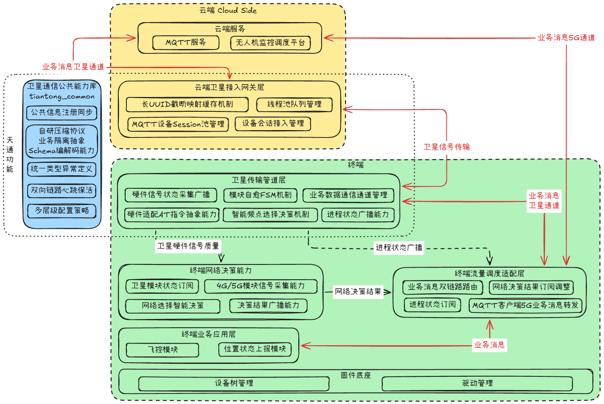
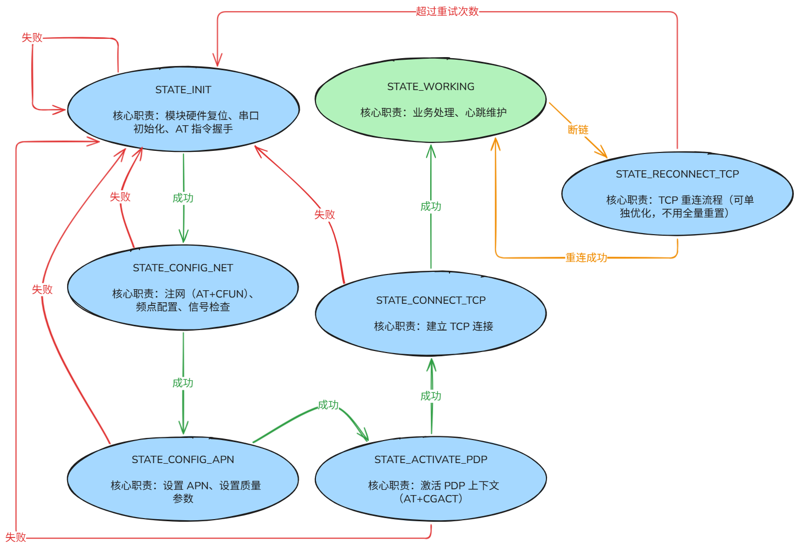
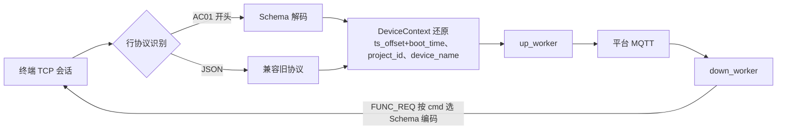
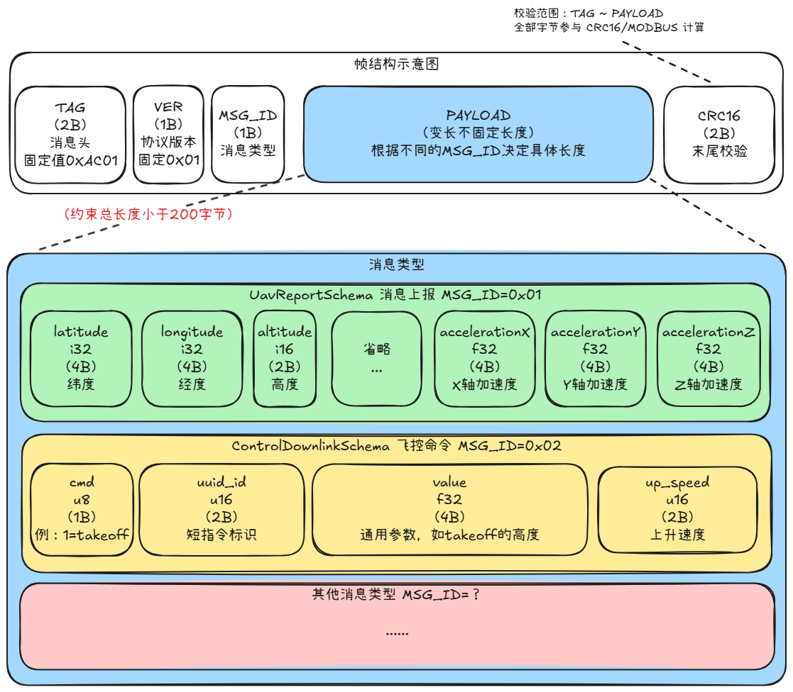
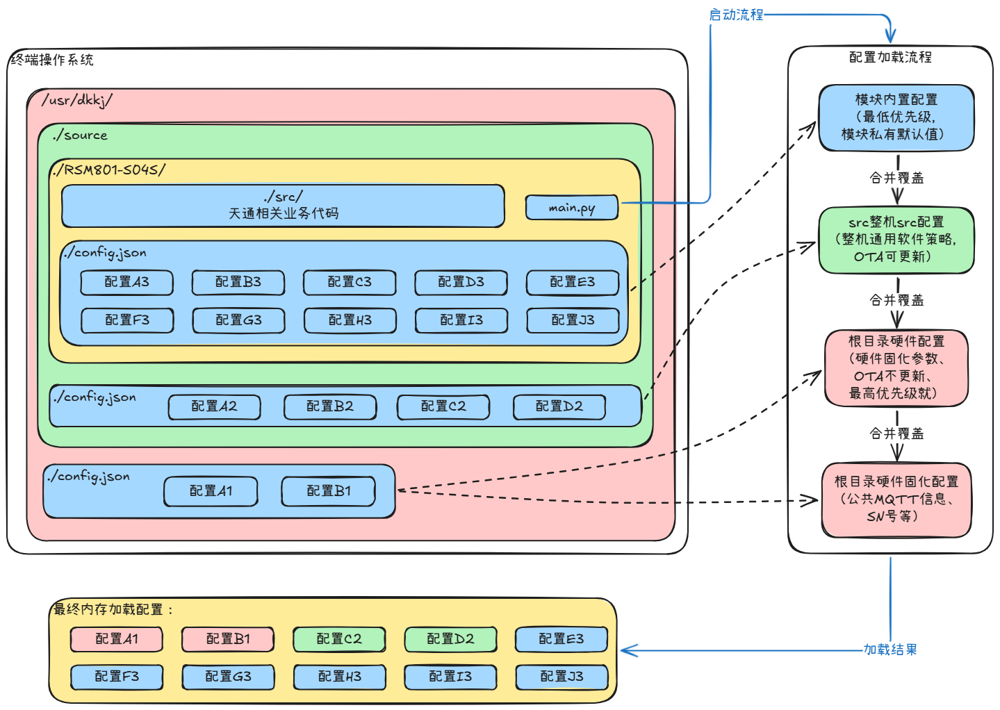
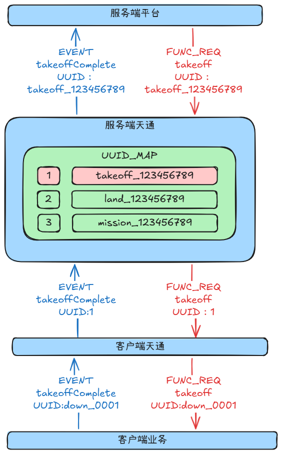
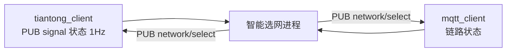

# 天通卫星通信终端与服务端

> 在窄带卫星链路上重建一条"能跑起来、出问题能定位"的双向通信通道：端侧 FSM + AT 驱动、二进制 Schema 压缩、服务端接入网关。
> 这是离职前主动接手的最后一个需求——上一任做了半年仍未可用，因此选择从零重新设计。

---

## 1. 文档信息

| 项目名称 | 天通模组通讯链路（RSM801-S04S） |
|-----------|------------------------|
| 阶段 | 设计 → 实现 → 联调 → 转测 |
| 技术栈 | Python、AT 指令/串口、TCP、MQTT、ZMQ、二进制协议、多线程与看门狗 |
| 周期 | 约两个月（未达稳定，遗留项见第 9 节） |

---

## 2. 系统概述

### 2.1 设计目标

1. **链路高可靠**：针对模组搜星失败、AT 超时、卫星 TCP 断连、串口异常等随机故障，配套状态机自愈、线程看门狗、链路保活与重试退避；
2. **极致带宽优化**：在窄带小包约束下，自研二进制 Schema 压缩，端侧裁剪字段、二进制编码、长 UUID 短映射，云端反向还原；
3. **业务无侵入**：通信层作为独立中间件，不改动存量飞控/RemoteID 业务代码；
4. **双链路调度**：与现有 5G MQTT 通路共存，按卫星链路实时状态切换，避免"启停进程"式粗糙切换。

### 2.2 约束与对策

| 约束 | 实际情况 | 对策 |
|------|---------|------|
| 带宽 | 模组单帧稳定载荷约 **100 字节**；`AT+RISENDEX` 单次 HEX 上限 512 字符（256 字节原始数据）。平台一条状态上报 JSON 约 400 字节，早期去 key 压缩后仍有 250 字节，仍超标 | 二进制帧 + 字段定点化 + 冗余字段预注册 |
| 时延 | 卫星往返 RTT 1~3 秒 | 上行队列限流、下行单会话串行、非关键事件合并 |
| 硬件稳定性 | 搜星失败 / AT 超时 / TCP 断连 / 串口异常随机发生 | FSM 异常回退 INIT；线程看门狗；周期保活 |
| 业务兼容 | 存量进程不可修改 | ZMQ 进程间广播桥接，业务沿用原有交互方式 |
| 双链路共存 | 5G 与天通同时在线 | 卫星状态 1Hz 广播给选网进程，统一输出切换策略 |

### 2.3 架构总览



定位是**纯卫星传输管道**：`tiantong_client` 与 `tiantong_server` 不承载业务解析与调度，业务压缩预处理、多链路协同统一收敛到终端 `mqtt_client` 流量调度中心。

### 2.4 进程与线程模型

**终端 `tiantong_client`**（8 条线程）

| 线程 | 职责 |
|------|------|
| main | FSM 驱动、线程生命周期、异常重启 |
| serial_rx | 串口持续读取，区分 URC / AT 响应 / 二进制帧 |
| tcp_tx | 从 up_queue 取业务消息走 `AT+RISENDEX`，带退避重试 |
| tcp_rx_dispatch | 解析下行，分发到 down / local_down / control 队列 |
| signal | 周期采样 `AT+IOTCSQ`，ZMQ 广播 + 落盘，SNR 过低触发重连 |
| control | 消费 control_queue，处理 at_error / signal_poor / send_failed |
| watchdog | 5s 巡检，异常退出的线程按工厂函数重建 |
| bridge_server | Unix socket 服务端，接收本机业务进程连接 |

**服务端 `tiantong_server`**

| 线程 | 职责 |
|------|------|
| accept | TCP 监听与接入 |
| device_session（每设备 1 条） | 解析终端消息、协议转换、队列投递 |
| up_worker / down_worker | TCP→MQTT 上行 / MQTT→TCP 下行（含二进制压缩） |
| keepalive_worker | 会话超时检测、PING 发送、空闲清理 |
| control_loop / status_loop | 链接控制事件 / 周期打印 sessions·mqtt_clients·队列积压 |

设计意图是"每个方向一条独立的路"：串口不能等、网络不能等、业务不能等，谁等谁就把整条链路拖死。

---

## 3. 终端设计

### 3.1 状态机（8 状态）



`INIT → CONFIG_NET → CONFIG_APN → ACTIVATE_PDP → CONNECT_TCP → REGISTER → WORKING`，断链进 `RECONNECT_TCP`。

| 状态 | 关键动作 | 成功判据 |
|------|---------|---------|
| INIT | 打开串口、AT 握手、（可选）GPIO 断电重启模组 | AT OK |
| CONFIG_NET | CFUN 激活、频点遍历 | `AT+CREG?` 返回已注册 |
| CONFIG_APN | `CGDCONT` / `CGEQREQ` | OK |
| ACTIVATE_PDP | `CGACT` 激活 | 拿到 IP |
| CONNECT_TCP | `RIOPEN` 建链 | `+RIOPEN: 0,0` |
| REGISTER | 自动向服务端注册并等 ACK | 注册成功 |
| WORKING | 启动工作线程、业务通信 | — |
| RECONNECT_TCP | `RICLOSE` → `RIOPEN` | 重连成功，超限回 INIT |

失败规则显式定义：CONFIG_NET/APN/PDP/TCP 失败一律回 INIT 全量重置；RECONNECT 超过重试次数回 INIT。

**把"怎么连上天通"写成状态，而不是一堆 if-else**，好处是任何失败都能从日志直接看到"卡在哪个状态、这一步在等什么"。

### 3.2 AT 层与串口异常

按职责拆成 `at_client`（发指令等响应）、`urc_parser`（解析模组主动上报）、`serial_port`（串口本身）。INIT 前留了 GPIO 电源循环钩子，默认关闭，现场模组假死时可配置打开——比发复位指令更彻底。

---

## 4. 服务端设计（卫星接入网关）

职责是"把窄带链路翻译回公网"：



- **每设备一个 session + 一个 MQTT 客户端**：注册阶段用 deviceName/deviceSecret 走 HTTP 换 `mqInfo`，成功后自动 connect（v1 需要终端再发控制指令，联调证明这一步只是多一个失败点，故去掉）；
- `DeviceContextStore` 保存每台设备的 project_id / device_name / boot_time，是"字段不上链路"能成立的前提；
- `SchemaRegistry` 做 MSG_ID → Schema 映射，加一种指令只加一个 Schema 文件。

---

## 5. 公共层：二进制协议与配置

### 5.1 帧结构与 Schema



```
TAG(2B, AC01) | VER(1B) | MSG_ID(1B) | PAYLOAD(变长) | CRC16(2B)
```

| MSG_ID | 方向 | 长度 | 说明 |
|--------|------|------|------|
| 0x01 | 上行 | 34B payload | 无人机状态上报（1Hz），帧 40B |
| 0x02 | 下行 | 7B | 控制指令（cmd / uuid 短标识 / f32 参数） |
| 0x03 | 下行 | 1+N×12B | 航线任务，最多 16 航点（帧 ≤199B） |
| 0x06 | 双向 | 5B | PING/PONG 保活，帧 11B |

压缩的关键不是"把 JSON 压小"，而是**不变的东西一律不上链路**：经纬度 ×10⁷ 存 i32、高度 ×10 存 i16、速度 ×100 存 u16、模式与状态用 1 字节枚举；时间只传相对开机时刻的 u16 偏移，由服务端加 boot_time 还原；deviceName / productKey / projectId / topic 一个字节都不传，服务端按上下文拼回。

一帧状态上报 40 字节，转 HEX 是 80 字符加一个换行，服务端按行读取时正好 81 字节——这就是日志里那条 `session recv bytes=81`。

### 5.2 配置分层



模块内置默认 → `source` 整机配置（OTA 可更新）→ 根目录硬件配置（最高优先级）→ 公共硬件固化（MQTT 信息、SN 等），逐层 deep merge。同一份代码在不同产品上只换配置。

### 5.3 UUID 短标识映射



平台侧指令 UUID 是长字符串，直接上行/下行会占掉大半载荷。服务端维护 `UUID_MAP`：短标识（1 字节序号）↔ 原始 UUID 双向映射，链路只传短标识，两端各自还原。

### 5.4 日志与异常

统一 `dkkj_logger` 封装，按模块（comsat / mqtt）分级开关，普通日志保留 30 天、告警日志 180 天；异常按层次自定义（AT 层 / 传输层 / 协议层 / 业务层），便于日志直接定位失败层级。

---

## 6. 多链路选网



选网不再"启动/停止天通"，而是持续广播选网结果，各链路自己判断是否承载业务；同时做上下行过滤，避免 5G 与卫星双通道重复下发。

---

## 7. 可靠性设计

| 机制 | 参数 / 做法 |
|------|-------------|
| 上行重试 | 退避 1/2/4/8 秒，最多 5 次，失败投递 `send_failed` 事件到 control_queue |
| 下行保活 | 服务端每 30s 发 PING；120s 无活动则踢出会话、断开 MQTT、释放 socket，防半开连接占资源 |
| 注册 ACK | REGISTER 阶段门控上行：未收到 ACK 前丢弃业务上行，避免服务端上下文未建立时产生垃圾数据 |
| 线程看门狗 | 5s 巡检，通过 thread_factories 重建 serial_rx / tcp_tx / tcp_rx_dispatch / signal / control |
| worker 保护 | down_worker 外层 try/except，未预期异常后 0.5s 自动重启 |

---

## 8. 测试与转测

没有那么多真机和卫星时间，所以先把链路做成可自证：

- **虚拟天通模组**：伪装成串口设备，模拟 AT 指令、注网、PDP 激活、`RIOPEN`、`RISENDEX`，并把数据桥接到真实 TCP；
- **一键拉起**：虚拟模组 + 服务端 + 客户端 + 日志监控四条命令同时起，检查服务端日志出现 `binary frame decoded msg_id=0x01` → `restored to platform json` → `up worker publish done`，再到平台上确认有一架飞机位置在动；
- **单元与集成测试**：客户端 AT 解析 / 状态机 / 频点选择 / GPIO 上电 / 信号 ZMQ，公共层各 Schema 编解码与 UUID 压缩，服务端 session / router / keepalive / mqtt manager / worker，另有 7 个集成测试；测试跑在 Docker 内，保证 pyzmq 等依赖不被 skip；
- **转测交接报告**：按 TT-P0-xxx 用例编号准备命令、截图、日志、结论，Go/No-Go 准入项逐条判定。

---

## 9. 已知限制（坦白项）

| 问题 | 说明 |
|------|------|
| 未做长周期浸泡 | 24h/72h 浸泡测试未完成，转测范围中明确列为"不包含" |
| 多设备并发未压测 | 服务端是一设备一 session 一 MQTT 客户端，两三台正常，二三十台未验证 |
| 真机覆盖有限 | 仅楼顶单点实测，天线位置、天气、遮挡对锁星影响大 |
| 重试策略未自适应 | 链路已拥塞时固定 1/2/4/8 退避会放大拥塞 |
| 串口长跑偶发无响应 | 兜底手段是看门狗 + GPIO 断电重启，属"能救回来但未治本" |
| 注册 ACK 版本 | v2.1 设计完成、实现未收尾即交接 |

---

## 10. 复盘

- **窄带思维和宽带思维是两套东西**。做 RTK 时是"尽力而为的实时流"，丢一帧无所谓；做天通是"每个字节都要签字"，40 字节里每个 bit 都得有理由。这种约束逼着把协议想清楚，反过来看公网侧会发现很多地方一直在浪费。
- **显式状态机是可运维的前提**。同样的故障，有 FSM 能一句话定位，没有 FSM 只能靠猜。
- **测试环境要能替代硬件**。虚拟模组让整条链路在没有卫星、没有真机的情况下可复现，这是能在两个月内推进的前提。
- 遗憾是它没有跑到"稳定"——文档、状态机、Schema、测试、转测报告该留的都留了，但最后一天推上去的还是 `v2.1 设计更新（待实现）`。
