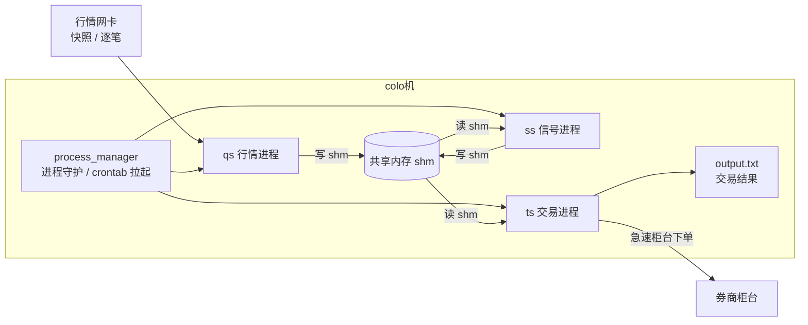
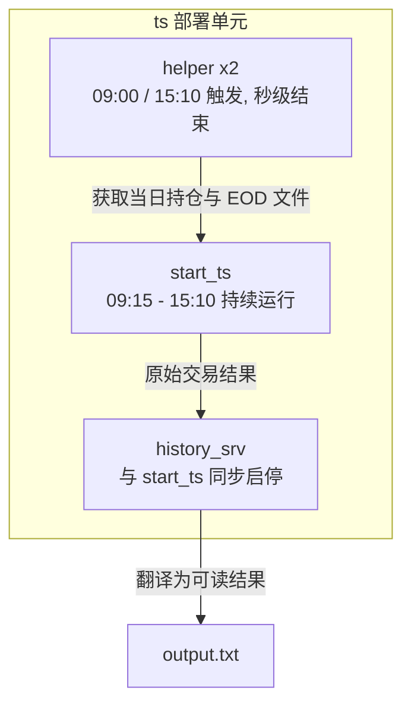
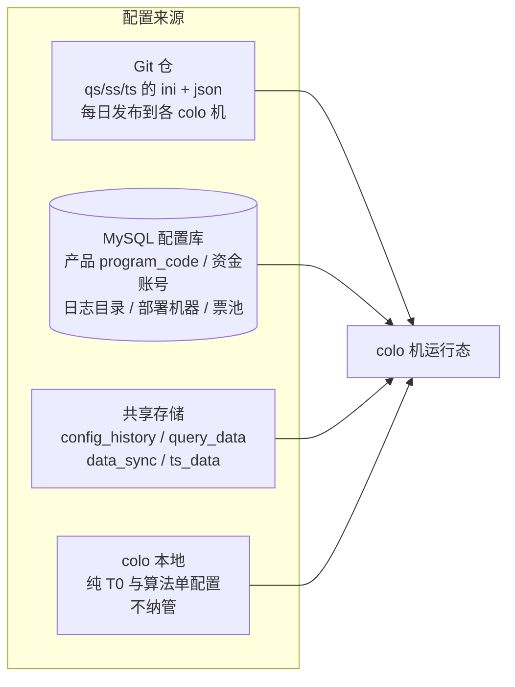
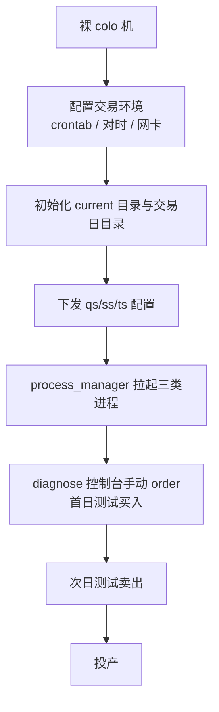
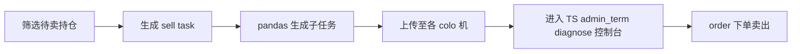
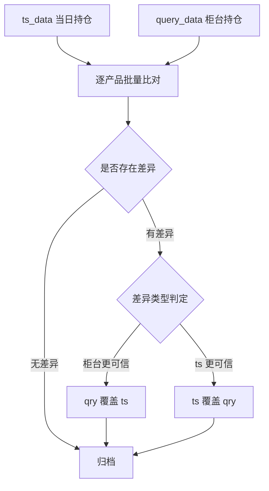
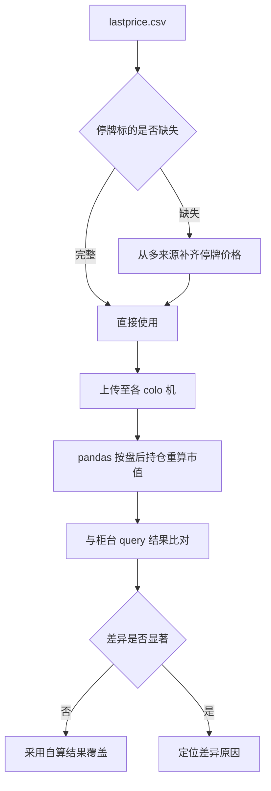
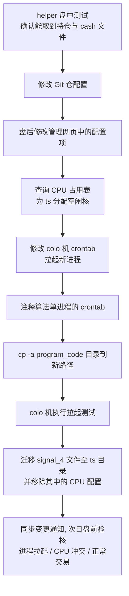
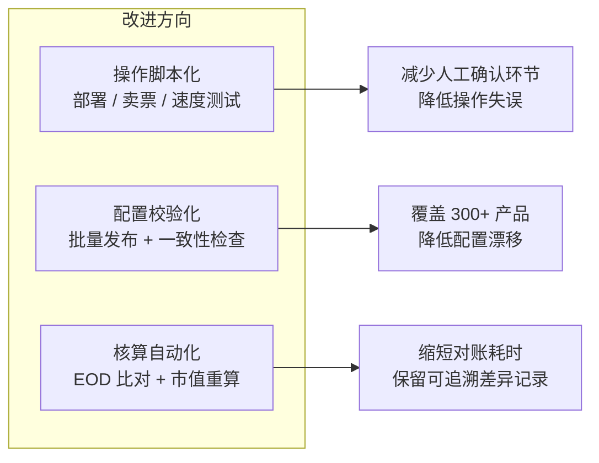

# 📈 股票量化实盘交易系统 — 运维自动化与数据核对

> 面向 colo 机房实盘交易的运维侧工程实践，核心能力：多进程生命周期管理、多源配置治理、盘后数据核对自动化、运维动作工具化

## 项目基础信息

| 项目名称 | 股票量化实盘交易系统运维自动化 |
|-----------|------------------------|
| 周期 | 2026.08 - 2026.11 |
| 技术栈 | Python / pandas / Linux / crontab / Shell / 多进程与共享内存 / Git / MySQL |
| 场景 | 股票 T0 与 TWAP 策略的实盘进程部署、盘中保障与盘后数据处理 |
| 职责 | 实盘进程部署与生命周期管理、配置治理、盘后对账与市值核算脚本开发、运维工具化 |

---

# 一、系统整体架构

## 1.1 三层进程模型

实盘系统运行在与券商对接的 colo 机上，由 `crontab` 挂载 `process_manager` 守护进程，再由它拉起三类业务进程，形成「行情 → 信号 → 交易」的单向数据链路：

| 进程 | 职责 | 关键说明 |
|------|------|----------|
| `qs` | 行情接入 | 通过行情网卡获取快照与逐笔数据，除原始行情外还根据逐笔自行合成 OB 行情，写入 shm 供下游读取 |
| `ss` | 信号生成 | 读取行情 shm，结合每日上传的信号参数生成信号，读一个 shm、写一个 shm，因此**每日信号文件正确性是实盘前提** |
| `ts` | 交易执行 | 最核心进程，读取行情与信号，按策略 so（T0 / TWAP 等）通过急速柜台实际下单，输出 `output.txt` |

## 1.2 TS 的四个运行单元

`ts` 并非单进程，而是一组按交易时段调度启停的单元，部署时需成套拉起：

| 单元 | 调度 | 作用 |
|------|------|------|
| `helper`（两个） | 每日 09:00 与 15:10 各执行一次，数秒结束 | 从柜台获取当日持仓与 EOD 文件 |
| `start_ts` | 每个交易日 09:15 - 15:10 持续运行 | 主交易进程 |
| `history_srv` | 与 `start_ts` 同步启停 | 将当日交易结果翻译为可读的 `output.txt` |

## 1.3 配置的四个来源

系统最难的部分不是代码，而是配置。300+ 个产品（按池子分为 300 / 500 / 1000 / 2000，按形态分为 alphaT、纯 T0、算法单）的配置分散在四处：

| 来源 | 内容 | 管理方式 |
|------|------|----------|
| Git 仓 | TS 目录下 `ts_config.ini`、`query_config_*.ini`、`query_param_config_*.ini` 等 | 每日从仓库发布到各 colo 机，**仅覆盖 alphaT，不含纯 T0** |
| MySQL 配置库 | `program_code` 与资金账号（联合唯一）、日志目录、上传路径、部署机器、部署形态、票池、产品 ID | 配套管理网页，日常即「改网页」 |
| 共享存储 | `config_history`（每日配置快照，可回滚）、`query_data`（柜台持仓与市值现金归档）、`data_sync`（`secmaster.csv`、`stock_cat.csv` 等）、`ts_data`（TS 计算的最终持仓与市值） | 挂载于虚拟机，由每日拉取脚本与分仓脚本维护 |
| colo 本地 | 纯 T0 与算法单配置 | 落在机器上不再变动，**游离于版本管理之外** |

这种四源割裂是配置漂移的根因：同一产品的有效配置由「哪几个来源叠加」决定，且纯 T0 / 算法单完全不在 Git 覆盖范围内，任何一次人工改动都缺乏校验与留痕。

---

# 二、核心工作内容

## 2.1 实盘进程部署

新机器或新产品上线时，需要参照已有机器手工部署一整套 `qs` / `ss` / `ts`，实机验证后方可投产。

- 覆盖对时、交易日目录创建与盘后目录清理，这些动作原先依赖口头确认，现已固化为可复现的脚本流程
- 新增券商机器上线时，从裸机开始完成 crontab、对时、目录脚本、网卡与三进程拉起测试

## 2.2 盘中保障

| 时段 | 动作 |
|------|------|
| 盘前 | 检查各产品进程启动状态，处理 `authorise`（授权）失败的产品 |
| 盘中 | 监控进程状态，处置授权失败、CPU 核冲突、链路异常等即时问题 |
| 盘后 | 执行对账、市值核算、次日配置准备 |

## 2.3 卖票任务下发

每日需筛出应卖出的持仓（策略不再持有、ST、低价高风险、打新等），生成卖票任务并下发到各 colo 机执行。

工程上的改进点在于把这条链路的脚本参数、单次卖出限额、回显判定条件显式化，减少「记错脚本顺序 / 参数输错」这类操作风险。

## 2.4 盘后 EOD 对账

交易结束后批量比对 `ts_data` 与 `query_data` 两侧的 EOD 持仓，按差异类型决定覆盖方向：

这里的关键不是脚本本身，而是差异归因的经验规则：需要结合当日是否有手工调整、分仓、停牌、部分成交等情况判断哪一侧可信。这部分已逐步沉淀为可独立执行的判断流程。

## 2.5 盘后市值核算

`lastprice.csv` 在本地共享存储与各 colo 机之间往返，是市值计算的唯一价格输入。

这是相对独立负责的一块，涉及跨机器文件分发、跨源数据合并与结果交叉校验三个环节。

## 2.6 算法单转 alphaT

将原本由算法单交易的产品切换为 alphaT 形态。表面是一句「换一种部署形态」，实际横跨四类配置来源与两个调度系统：

12 个步骤分布在 Git、网页、CPU 表、colo crontab、共享存储与实盘沟通群六个位置，任何一步遗漏都可能在次日盘中才暴露。这类流程是工具化的高价值目标。

## 2.7 速度测试接入

为每个账户与对应柜台的下单速度建立基线，需要在既有 T0 / TWAP 之外新增一类 test 形态：

- 修改 `ts_config.ini`，新增两个 `query_config_test` 相关配置文件
- 依赖每晚 CI 流程发布到对应 colo 机的文件
- 晚间拉起进程验证，次日盘中确认正常交易

---

# 三、工程化改进

上述工作原先大量依赖人工按经验操作与口头确认。在岗期间的主要工程化投入集中在三点：

| 方向 | 具体做法 | 收益 |
|------|----------|------|
| 操作脚本化 | 将部署、卖票下发、速度测试接入等高频动作写成带参数校验的脚本 | 降低对个人经验的依赖与操作失误 |
| 配置校验化 | 编写批量发布与一致性校验脚本，替代手工 scp 逐机下发 | 减少四源割裂导致的配置漂移 |
| 核算自动化 | pandas 实现 EOD 批量比对、停牌价格补齐与盘后市值重算，并与柜台结果交叉校验 | 缩短对账耗时，差异可追溯 |

---

# 四、能力沉淀

1. **多进程系统运维**：理解 qs/ss/ts 三层数据链路与共享内存通信模型，能独立完成整套实盘进程的部署、启停与异常处置
2. **Python 数据工程**：基于 pandas 完成跨源数据合并、差异比对与批量核算，处理停牌、分仓、部分成交等真实边界情况
3. **配置治理意识**：识别多源配置割裂带来的漂移风险，从批量发布与一致性校验两个方向收敛
4. **流程工具化**：把跨系统、多步骤、易遗漏的人工流程拆解为脚本与检查项，降低对个人经验的依赖
5. **生产环境判断力**：在盘中午盘等强时效场景下定位并处置进程、授权、CPU、链路类故障

---

# 五、复盘

- **配置四源割裂是这类系统的结构性负债**。Git 只覆盖 alphaT，纯 T0 与算法单游离在版本管理外，任何治理方案都必须先解决「有效配置由谁决定」这个问题，否则在 Git 之上再套一层仓库并不能消除混乱。
- **缺少校验与留痕比缺少工具更致命**。人工流程本身不必然出错，但无验收标准、无日志留痕时，错误只能在实盘暴露，代价极高。
- **跨系统流程应该被显式建模**。算法单转 alphaT 这类 12 步流程，适合用清单 + 校验脚本的方式固化，而不是依赖交接时的口头演示。
- **对账的本质是归因**。脚本只能给出差异，能否判断哪一侧可信取决于对业务的理解，这部分才是这类岗位真正的门槛。