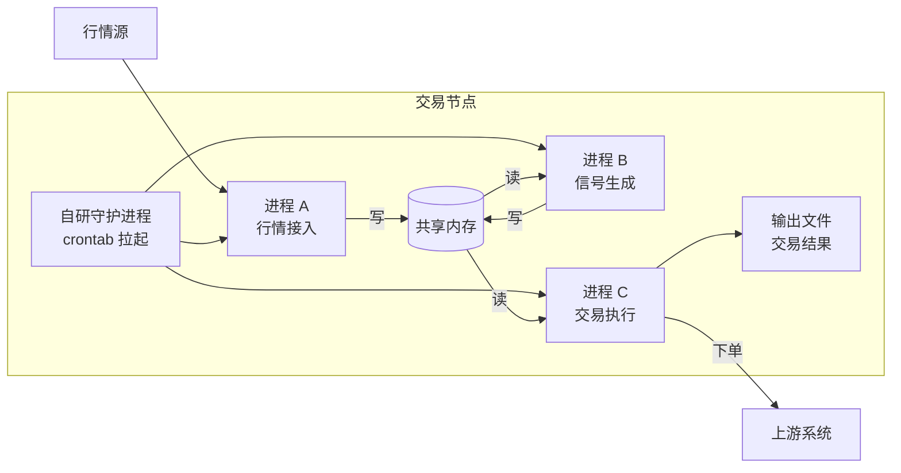
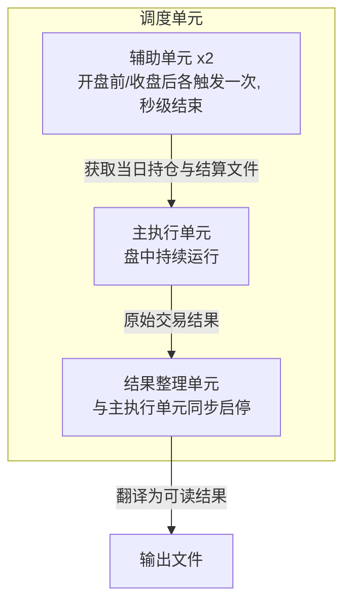
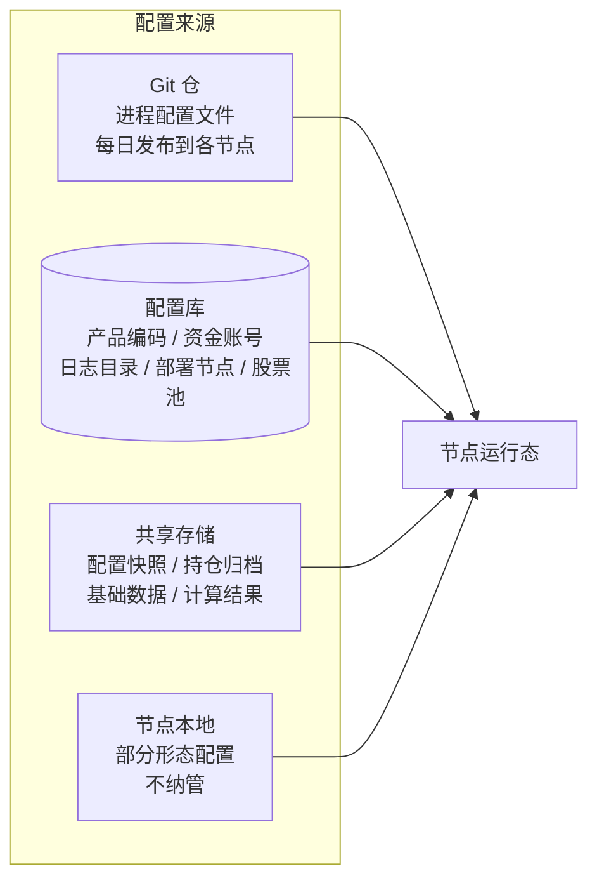
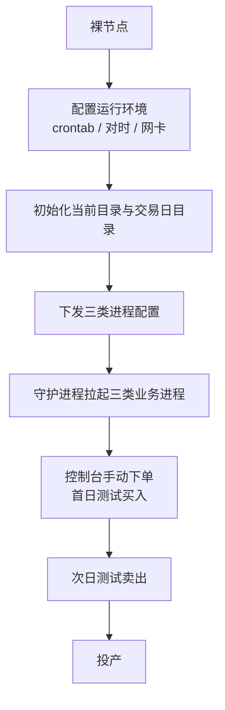
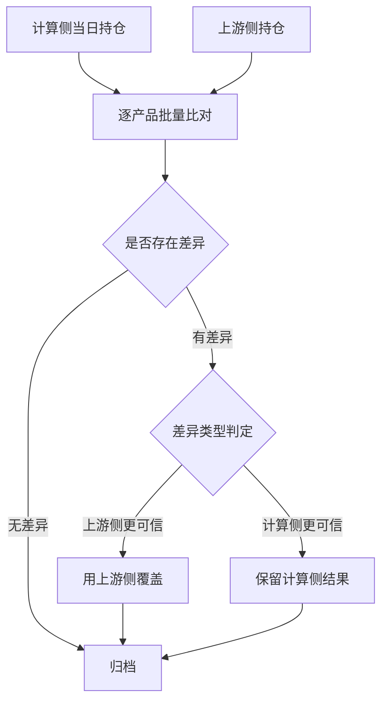
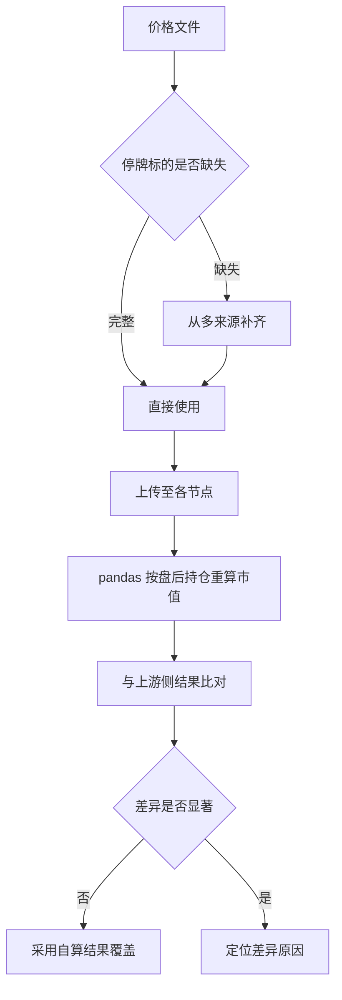
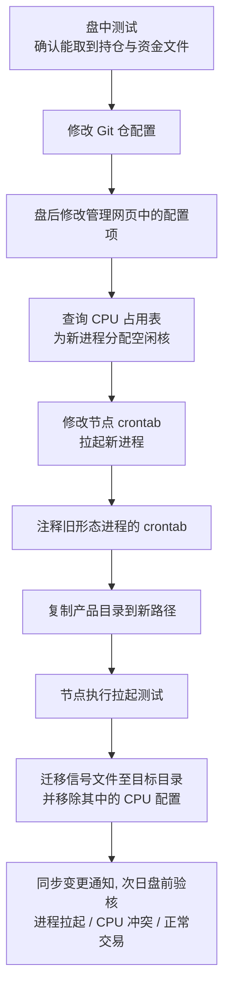
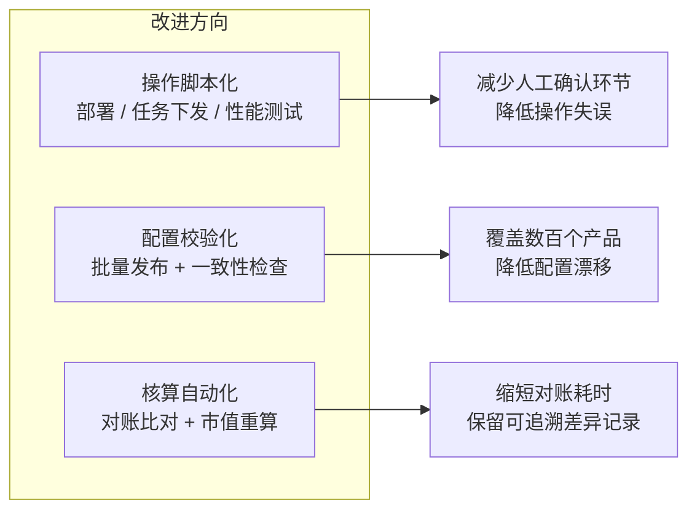

# 📈 量化实盘系统 — 运维自动化与数据核对

> 面向低延迟实盘交易的运维侧工程实践：多进程生命周期管理、多源配置治理、盘后数据核对自动化、高频操作工具化

## 项目基础信息

| 项目名称 | 量化实盘交易系统运维自动化 |
|-----------|------------------------|
| 周期 | 2026.08 - 2026.11 |
| 技术栈 | Python / pandas / Linux / crontab / Shell / 多进程与共享内存 / Git / MySQL |
| 场景 | 实盘交易进程的部署、盘中保障与盘后数据处理 |
| 职责 | 进程部署与生命周期管理、配置治理、盘后对账与市值核算脚本开发、运维工具化 |

---

# 一、系统架构

## 1.1 三层进程模型

实盘系统运行在托管机房的交易节点上，由 `crontab` 挂载自研守护进程，再由它拉起三类业务进程，形成「行情 → 信号 → 交易」的单向数据链路。机内通过共享内存传递数据，规避进程间拷贝开销：

| 进程 | 职责 | 关键说明 |
|------|------|----------|
| 进程 A | 行情接入 | 获取快照与逐笔数据，并基于逐笔自行合成盘口行情，写入共享内存供下游读取 |
| 进程 B | 信号生成 | 读取行情共享内存，结合每日上传的信号参数生成信号；读一块、写一块，因此**每日信号参数的正确性是实盘前提** |
| 进程 C | 交易执行 | 最核心进程，同时读取行情与信号，按策略执行下单并输出结果文件 |

## 1.2 交易执行的调度单元

进程 C 并非单一进程，而是一组按交易时段调度启停的单元，部署时必须成套拉起：

这类「按时间窗成组启停」的调度结构，决定了部署脚本不能只拉起单个进程，而要按单元成组处理，并保证前后依赖顺序。

## 1.3 配置的四个来源

系统最难的部分不是代码，而是配置。数百个产品（按池子规模、按交易形态区分）的配置分散在四处：

| 来源 | 内容 | 管理方式 |
|------|------|----------|
| Git 仓 | 交易执行与查询相关的多个 ini 配置文件 | 每日从仓库发布到各节点，**仅覆盖部分交易形态** |
| 配置库 | 产品编码与资金账号（联合唯一）、日志目录、上传路径、部署节点、部署形态、股票池 | 配套管理网页，日常即「改网页」 |
| 共享存储 | 每日配置快照（可回滚）、持仓与资金归档、基础数据文件、计算结果 | 挂载于虚拟机，由每日拉取脚本与分仓脚本维护 |
| 节点本地 | 部分交易形态的配置 | 落在机器上不再变动，**游离于版本管理之外** |

这种四源割裂是配置漂移的根因：同一产品的有效配置由「哪几个来源叠加」决定，且部分交易形态完全不在 Git 覆盖范围内，任何一次人工改动都缺乏校验与留痕。

---

# 二、核心工作内容

## 2.1 实盘进程部署

新节点或新产品上线时，需要参照已有节点部署一整套进程，实机验证后方可投产。

- 覆盖对时、交易日目录创建与盘后目录清理，这些动作原先依赖口头确认，现已固化为可复现的脚本流程
- 新增节点上线时，从裸机开始完成 crontab、对时、目录脚本、网卡与三类进程拉起测试

## 2.2 盘中保障

| 时段 | 动作 |
|------|------|
| 盘前 | 检查各产品进程启动状态，处理授权失败的产品 |
| 盘中 | 监控进程状态，处置授权失败、CPU 核冲突、链路异常等即时问题 |
| 盘后 | 执行对账、市值核算、次日配置准备 |

## 2.3 批量任务下发

每日需筛出应处理的持仓，生成批量任务并下发到各节点执行。

工程上的改进点在于把这条链路的脚本参数、单次限额、回显判定条件显式化，减少「记错脚本顺序 / 参数输错」这类操作风险。

## 2.4 盘后数据对账

交易结束后批量比对计算侧与上游侧的持仓，按差异类型决定覆盖方向：

这里的关键不是脚本本身，而是差异归因的经验规则：需要结合当日是否有手工调整、拆分、停牌、部分成交等情况判断哪一侧可信。这部分已逐步沉淀为可独立执行的判断流程。

## 2.5 盘后市值核算

行情价格文件在共享存储与各节点之间往返，是市值计算的唯一价格输入。

这是相对独立负责的一块，涉及跨机器文件分发、跨源数据合并与结果交叉校验三个环节。

## 2.6 部署形态切换

将原本以某一形态运行的产品切换为另一形态。表面是一句「换一种部署形态」，实际横跨四类配置来源与两个调度系统：

十几个步骤分布在 Git、网页、CPU 表、节点 crontab、共享存储与沟通群六个位置，任何一步遗漏都可能在次日盘中才暴露。这类流程是工具化的高价值目标。

## 2.7 链路性能基线接入

为每个账户与对应通道的下单速度建立基线，需要在既有形态之外新增一类测试形态：

- 修改交易执行侧配置，新增两个与测试查询相关的配置文件
- 依赖每晚 CI 流程发布到对应节点的文件
- 晚间拉起进程验证，次日盘中确认正常交易

---

# 三、工程化改进

上述工作原先大量依赖人工按经验操作与口头确认。在岗期间的主要工程化投入集中在三点：

| 方向 | 具体做法 | 收益 |
|------|----------|------|
| 操作脚本化 | 将部署、任务下发、性能测试接入等高频动作写成带参数校验的脚本 | 降低对个人经验的依赖与操作失误 |
| 配置校验化 | 编写批量发布与一致性校验脚本，替代手工逐机下发 | 减少四源割裂导致的配置漂移 |
| 核算自动化 | pandas 实现持仓批量比对、停牌价格补齐与盘后市值重算，并与上游侧结果交叉校验 | 缩短对账耗时，差异可追溯 |

---

# 四、能力沉淀

1. **多进程系统运维**：理解三层数据链路与共享内存通信模型，能独立完成整套实盘进程的部署、启停与异常处置
2. **Python 数据工程**：基于 pandas 完成跨源数据合并、差异比对与批量核算，处理停牌、拆分、部分成交等真实边界情况
3. **配置治理意识**：识别多源配置割裂带来的漂移风险，从批量发布与一致性校验两个方向收敛
4. **流程工具化**：把跨系统、多步骤、易遗漏的人工流程拆解为脚本与检查项，降低对个人经验的依赖
5. **生产环境判断力**：在强时效场景下定位并处置进程、授权、CPU、链路类故障

---

# 五、复盘

- **配置四源割裂是这类系统的结构性负债**。Git 只覆盖部分交易形态，其余游离在版本管理外，任何治理方案都必须先解决「有效配置由谁决定」这个问题，否则在 Git 之上再套一层仓库并不能消除混乱。
- **缺少校验与留痕比缺少工具更致命**。人工流程本身不必然出错，但无验收标准、无日志留痕时，错误只能在生产环境暴露，代价极高。
- **跨系统流程应该被显式建模**。十几个步骤的形态切换流程，适合用清单 + 校验脚本的方式固化，而不是依赖交接时的口头演示。
- **对账的本质是归因**。脚本只能给出差异，能否判断哪一侧可信取决于对业务的理解，这部分才是这类岗位真正的门槛。